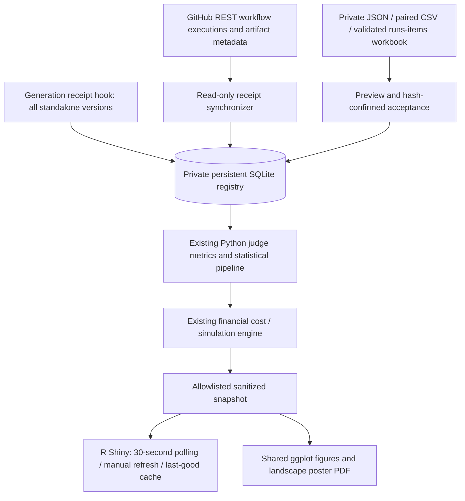

# Research dashboard V4.1: architecture and operation

Starting branch: `feat/fmea-skill-v4-research-dashboard`.
Starting commit: `9f110cda11a717b7df0533a572c908d62222fcee`.
No new FMEA skill version is created by this dashboard release. V2, remote V3,
V3-audit and V4 prompts and generation settings are preserved. Package version 0.3
is distinct from standalone skill versions and dashboard version 4.1.

## Existing functionality reused

V4 already supplied the standalone generator/audit, identifier-only judge importer,
run/item metrics, bootstrap/ANOVA methods, immutable build exports, Shiny polling,
last-good cache and poster PDF. V4.1 extends these with a normalized registry,
GitHub API synchronization, deferred private judge acceptance and financial adapters.
The financial adapter uses `cost_model.comparison` and `uncertainty.simulate` from
`analysis/financial_impact`, retaining its missing-cost and scenario conventions.



## Durable identities and lifecycle

Workflow execution key is `repository/run-id/attempt`; a workflow may have several
jobs and FMEA receipts. Workflow records preserve repository, name, run ID/attempt,
job IDs, SHA, branch, event, creation/start/completion times, status/conclusion and URL.
A workflow success never establishes that an FMEA exists.

Generation IDs are stable explicit receipt IDs or hashes of receipt execution identity.
A planned study ID is an alias, not a workflow ID. A verified receipt fills its existing
planned record. A rerun with no new receipt adds no FMEA; genuinely new generation
receipts are distinct attempts, never silently relabeled as independent replicates.
Aliases can become ambiguous: use generation_id when importing evaluations. Legacy
`results/github/<run-id>/` folders provide parent-run provenance where available,
but an unverified workflow attempt remains null rather than assuming attempt 1.

Evaluations have distinct evaluation_id values (explicit or deterministic export hash).
Exact duplicates are idempotent; conflicting IDs fail. The first accepted evaluation
is selected. Later evaluations remain separate and do not replace it automatically.
Selection is an explicit, cohort-validated action. Statistics contain one selected
evaluation per generation so repeated judging does not inflate the sample size.

Lifecycle: PLANNED -> QUEUED -> RUNNING -> GENERATED -> AWAITING_JUDGE -> JUDGE_IMPORTED
-> EVALUATED -> HUMAN_REVIEW_PENDING -> COMPLETE. GENERATION_FAILED and VALIDATION_FAILED
are distinct failure states with controlled recovery transitions. Append-only events
preserve changes. Invalid imports roll back; they do not downgrade valid existing
quality results. Schema validity and an unauthenticated review record are not engineering
approval or judge correctness guarantees.

## Windows 11 / PowerShell / Positron

From the repository root:

```powershell
python -m pip install -r requirements.txt
python -m pip install -e ".[round2]"
New-Item -ItemType Directory -Force .venv/r-library
Rscript -e "install.packages(c('shiny','bslib','ggplot2','jsonlite','testthat'),lib='.venv/r-library',repos='https://cloud.r-project.org')"
Rscript -e ".libPaths(c('.venv/r-library',.libPaths())); shiny::runApp('dashboard',host='127.0.0.1',port=5385,launch.browser=FALSE)"
```

Open `http://127.0.0.1:5385`. Positron can run the same R expression. The app needs no
provider key. For reactive finance, set `SIGMA_PYTHON` to the project Python executable
if automatic `.venv/gemini/Scripts/python.exe` detection is unsuitable. Hosted finance
requires Python and the existing analysis modules, not just the R dashboard directory.

## Synchronize, backfill and monitor GitHub

Use server-side `GH_TOKEN` or `GITHUB_TOKEN` with repository Actions-read permission,
or GitHub CLI authentication managed on the workstation. This synchronizer reads its
token from process environment; it never requests generation or sends a token to Shiny.
The token must be supplied to this Python process; CLI login alone is not automatically
an environment variable. Unauthenticated public metadata requests are supported but
quickly rate limited. Do not print tokens or put them in browser controls.

```powershell
python -m analysis.research sync --metadata-only
python -m analysis.research sync --run-id RUN_ID
python -m analysis.research sync
python -m analysis.research reconcile
python -m analysis.research watch --interval 60
```

`sync` backfills supported generation workflow history and artifacts. `--metadata-only`
skips downloads. The full command downloads ZIPs but interprets **only standalone
`*_execution.json` members**, never raw FMEA rows/reference worksheets. Archive size
limits apply. Artifacts are copied into private local storage, not used as permanent
URLs. Signed download redirects never receive the GitHub Authorization header.
Completed unchanged executions are checkpointed, so subsequent polling skips their jobs
and already processed artifacts. New workflow attempts have separate checkpoint keys.
HTTP 403/429 limits preserve progress and record retry/reset information without an
automatic request retry. The last-successful-sync timestamp advances only on complete
success. API errors and rate limits remain visible. Polling is not real-time streaming.

`watch` runs on a persistent research workstation/server, synchronizes every 60 seconds,
and refreshes the shared snapshot and exports. Ctrl+C stops it. Shiny polls the file
mtime or approved sanitized HTTPS endpoint every 30 seconds; Refresh data reads it
immediately. Both are polling intervals, not a guaranteed instant update. All statistics
are Python-calculated. A failed import, export or update retains the last good snapshot.

For a different private local database, place the global argument BEFORE the command:

```powershell
python -m analysis.research --database results/my-study/registry.sqlite sync --metadata-only
python -m analysis.research --database results/my-study/registry.sqlite refresh --no-render
```

No synchronization command dispatches a workflow or calls Gemini/Claude. Full artifact
retrieval from private research runs needs an authorized credential; missing/expired
artifacts are reported, never reconstructed or counted as zero-quality FMEAs.

## Register plans, local receipts and legacy metadata

```powershell
python -m analysis.research register-plan --manifest results/v4/committed-plan/experiment_manifest.json
python -m analysis.research register-generation --receipt results/github/RUN_ID/system_B_v4.0_run02_execution.json
python -m analysis.research migrate --receipts results/first_execution.json results/second_execution.json
```

Migration normalizes existing standalone receipt contracts, preserving null historical
fields. It does not manufacture missing receipts from CSV rows or workflow success.
The generator's receipt writer records workflow context and generation_id across all
standalone versions. With `SIGMA_RESEARCH_DATABASE` configured, running/final receipts
update the registry and a sanitized local snapshot. Reporting errors leave generation
outcomes intact. The generation Actions job configures this hook; no generation settings,
retry permissions or paid-call limits are changed.

`research-refresh.yml` reacts to requested/in-progress/completed generation workflows.
It reads the source run and stages sanitized snapshot/figure artifacts with read-only
permissions and no model key. GitHub-hosted jobs remain ephemeral: the authoritative
persistent consumer is the workstation `watch` process or a configured self-hosted
runner with a durable private workspace. Do not substitute expiring artifacts for the
private database. A permanent sanitized endpoint and any public deployment remain
approval/configuration gates, not silently enabled publishing.

## Private judge import: preview, validate, accept

The authority is still `standalone-judge-import-1`, documented in the V4 runbook.
No new judge rubric or live judge client is introduced. The external judge remains
Claude Sonnet 5.5 / v1.2 for controlled comparisons, with the same human references.
Ground-truth wording and raw reference sheets are not inputs to this agent or generator.

```powershell
python -m analysis.research preview-judge --file results/imports/judge_export.json
python -m analysis.research accept-judge --file results/imports/judge_export.json --confirm-sha256 EXACT_PREVIEW_DIGEST
```

Preview returns generation/evaluation IDs, duplicate/selection flags and a confirmation
digest. Acceptance revalidates the file and current registry inside a transaction;
the digest prevents accepting changed files accidentally. Errors are private CLI errors,
not public upload responses. Unknown/ambiguous IDs, wrong system/version/model/settings,
wrong row counts, malformed items and incompatible selected cohorts fail. Ground-truth
text and judge notes never enter the sanitized snapshot.

Supported CSV and workbook adapters:

```powershell
python -m analysis.research preview-judge --file results/imports/runs.csv --items results/imports/items.csv
python -m analysis.research accept-judge --file results/imports/runs.csv --items results/imports/items.csv --confirm-sha256 EXACT_PREVIEW_DIGEST
python -m analysis.research preview-judge --file results/imports/analysis.xlsx
```

CSV uses the existing validated runs/items export columns. The confirmation covers BOTH
CSV files. XLSX support is specifically the repository's validated `runs` and `items`
sheets; unknown reference/FMECA workbooks are not supported. The adapter normalizes
JSON settings, booleans and numeric fields, then uses the original importer. It does
not infer item records from summary totals or guess classifications. Original files
are archived privately; evaluations are immutable.

Use the stable generation ID as run_id when a legacy alias is ambiguous. An optional
evaluation_id distinguishes independent repeats; include evaluation_timestamp,
ground_truth_version and comparison provenance. Missing provenance means descriptive
metrics may display, while inferential comparisons remain insufficient.

```powershell
python -m analysis.research select-evaluation --generation-id FMEA_ID --evaluation-id EVALUATION_ID
python -m analysis.research record-review --generation-id FMEA_ID --event-id REVIEW_ID --outcome complete --reviewed-at 2026-11-15T16:00:00-05:00 --minutes 20
```

Review events preserve the AI evaluation and original human records. Completion is an
explicit reviewer assertion, not authenticated approval. Repeated import/review IDs
cannot silently overwrite earlier decisions.

After acceptance, the command recalculates selected-run quality, system/version summaries,
confidence intervals, Pareto data, field accuracy, financial review scenarios, V4 criteria,
ggplots and poster. Repeated evaluations do not double-count generations or opportunities.
The historical aggregate baseline is never expanded into invented rows.

## Financial analysis and editable assumptions

Financial analysis distinguishes complete observed API spending, partial known invoices,
estimated API cost, modeled labor/savings and unavailable verified savings. Missing API
billing is never zero. Costs per success/evaluated FMEA allocate all recorded attempts;
labels identify denominators. Review-event minutes remain measured durations, while a
loaded-rate cost estimate remains a scenario, not an invoice.

Defaults: 50 FMEAs/year, $92.71/hour and manual time derived from the supplied historical
$43,851 planning cost. Setup, review/reconstruction, extra-row, approval, implementation,
maintenance and API/success/uncertainty controls are explicit editable assumptions.
The historical ~$34,800 AI operating cost, ~$5,551 first-year savings and reported
[-$9,475,$21,483] interval remain a separate preserved scenario. New projections are
recalculated using selected quality observations, or clearly labeled V2 report-derived
item counts when no evaluations are ingested. They do not reproduce an unavailable
historical simulation by inventing its distributions.

Changing a control triggers a debounced server-side Python calculation. No research
record changes. Reset restores the committed default assumptions. Monte Carlo uses
10,000 draws and seed 5300, retains losses, and reports an **assumption-driven 95%
simulation interval**, not a measured-savings confidence interval. Independent specified
distributions and a stationary geometric attempt assumption are inherited from the
existing financial engine. Figures show cost comparison, activity costs, simulation,
sensitivity, known billed spending and modeled review cost by version/system.

Private scripted scenario calculation uses the same code:

```powershell
python -m analysis.research finance --snapshot results/research/current.json --assumptions results/scenario-assumptions.json --output results/scenario-result.json
```

Copy `dashboard/data/financial-defaults.json` into ignored results/ and edit that copy.
No verified savings can be claimed without accepted, comparable manual/AI labor and
billing observations. Higher row count is not proof of engineering quality or benefit.

## Dashboard, figures and presentation

Six views: Mission control (default), Experiment explorer, Engineering quality,
Financial analysis, Research methodology and Presentation mode. Explorer filters
system/version/batch/date/generation/judge/workflow and searches run/model names.
Click or keyboard-activate a row for safe metadata, lifecycle and GitHub provenance.
Unverified parent workflow attempts stay unavailable. Private artifact paths, notes,
reference IDs and generated rows are excluded.

Mission KPIs identify their denominators. With no evaluated runs, the historical 31.4%
pooled missed rate and approximate sigma 2 are labeled V2 report aggregates, never V4
performance. The separate baseline retains 18/738/232/43, all supplied conditional
quality percentages and judge repeatability (97.9%, kappa .97), with no fabricated CI.

```powershell
python -m analysis.research refresh
Rscript dashboard/export.R results/research/current.json results/presentation/v41-export
```

Exports include shared coverage, Pareto, version comparison, field accuracy, activity,
quality-versus-row-count and financial PNG/PDF figures plus the landscape 24x13.5-inch
poster.pdf and presenter notes. Focus presentation selects the poster, hides navigation
and requests browser full screen. The same control restores it; Esc exits browser full
screen. Missing V4 evaluation remains explicit. Students must verify and rewrite
AI-assisted presentation prose and confirm the applicable course rubric.

## Recovery, security and deployment

SQLite/private raw archives/validated CSV+workbook and sanitized JSON are separate
layers. Back up the private registry and raw archive together using a consistent SQLite
backup while writers are stopped or the sqlite backup API. Do not publish the DB,
validated items, private raw archives, transient scenario inputs or GitHub tokens.
Accepted imports and snapshots are different stages: a rendering failure can leave a
valid accepted DB event with the previous published snapshot; retry `refresh` offline.
Never retry an uncertain paid generation as a synchronization recovery step.

For hosting, configure a durable private watcher workspace and an approved sanitized
endpoint, or a private server with the full Python analysis package alongside R.
Set SIGMA_DASHBOARD_DATA to the sanitized local/HTTPS snapshot; set SIGMA_PYTHON to
an interpreter containing the project dependencies for editable finance. Browser clients
never access GitHub credentials. No unauthenticated public judge upload exists.
Public publication, branch push and deployment require explicit approval. This change
implements local continuous polling; it does not claim a configured public live service.

Reconciliation reports unregistered workflows, incomplete generations, awaiting judgment,
missing/expired/orphaned artifacts, duplicate imports, ambiguous aliases and evaluations
without matching generations. A workflow with no receipt remains unregistered rather
than becoming a fabricated failed/zero-quality FMEA.

## Validation and current evidence

Before changes: 193 Python tests and 16 R assertions passed. New tests use synthetic
records for batch/retry/failure/duplicate/API-limit behavior, judge adapters/rollback,
explicit selection, billing gaps, simulation reproducibility, negative savings, lifecycle
and refresh/render failure. Real-data smoke test registered 30 public workflow executions
before hitting the unauthenticated API limit, plus 14 existing local receipt attempts
(8 success, 6 failure, 0 evaluated). Those operational receipts are not the reported
18-run judged baseline. No new model requests or live judging occurred.

The credential helper had no stored credential in this session. Full authenticated
artifact backfill and GitHub-triggered automation await a read credential and approved
branch publication; live V4 quality evaluation and verified savings remain unavailable.
