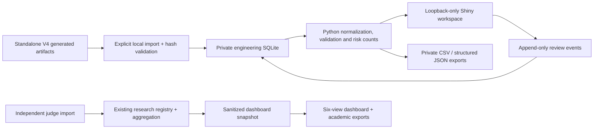

# V4.2 engineering workspace integration

## Repository audit

Starting branch: `feat/v42-premium-dashboard`, commit
`543321246beedb011b88cb7949d12eb795a15877`. Development branch:
`feat/v42-engineering-workspace`. All remote branches were fetched before editing.
The starting working tree was clean.

The premium branch contains the native chart refactor (`30f7783`), V4.1 registry,
judge and financial integration (`9cec0cb`), and V4 inventory/audit work (`9f110cd`).
Remote main (`1fc9630` at inspection) additionally contains merged V3 work and
single-run replicate changes. Those were inspected, not merged into this controlled
dashboard extension. Existing V2, V3, V3-audit and V4 prompt files remain intact.

| Classification | Finding and implementation decision |
|---|---|
| Already implemented — preserve | Six premium Shiny views, SVG dashboard charts, ggplot academic exports, SQLite research registry, judge preview/import, statistics and Python financial scenarios. |
| Implemented but incomplete — finish | Explorer tracked runs but could not inspect or review individual generated failure modes. Add a workspace subview instead of another top-level navigation. |
| Missing — add | Explicit private V4 imports, immutable originals, append-only corrections/decisions, evidence inspection, rating-safe risk counts, compatible run groups and selected-record exports. |
| Duplicated — consolidate | Reuse `standalone_v4.audit`, inventory checks, generator field names/rating scale, private path guard, existing chart helpers and visual tokens. No competing judge schema or financial implementation. |
| Obsolete | No existing production chart, generator or research implementation was removed. |

The frontend remains R Shiny/bslib with existing CSS and SVG helpers. The canonical
`src/sigma_fmea` package has its own versioning and workflow; it is not an adapter
input. The standalone default remains V2.0. V4.1/V4.2 are dashboard revisions,
**not new experimental skill treatments**.

## Boundaries and architecture



Engineering approval does not create a judge evaluation or alter reference coverage.
No engineering row is added to sanitized research JSON. No new public API or upload
endpoint exists. Public mode never opens the engineering database.

## Local Windows / Positron workflow

Run from the repository root. Existing environment dependencies still apply.
Import **generated V4 JSON**, its input-only inventory, and its generation receipt
from ignored local storage. Never supply reference FMEA/FMECA worksheets. These are
example artifact paths; substitute actual files from the same completed generation.

```powershell
.\.venv\gemini\Scripts\python.exe -m analysis.engineering import-v4 --response results/pilot/v4_response.json --inventory results/pilot/inventory.json --receipt results/pilot/receipt.json --dataset-version input-package-r1
Rscript dashboard/run_private.R
```

Open `http://127.0.0.1:5393/`. Under Experiment Explorer select **FMEA workspace**.
The standard public launcher is unchanged. An alternate private database may be set
with `$env:SIGMA_ENGINEERING_DATABASE = 'results/engineering/alternate.sqlite'`
before launching. All database/import/export paths must resolve inside `results/`.
Do not deploy this launcher publicly or expose it through a proxy/tunnel.

The receipt must identify `workflow=standalone_gemini`, `prompt_version=v4.0`,
experiment/attempt/system IDs, model settings, skill hash, Git commit, timestamp,
input hash and final generation status. Its inventory hash and artifact response
hash must match the actual bytes. This adapter reads no source worksheets and makes
no API requests. Bare legacy CSV files lack enough traceability and are rejected;
there is no inferred migration. Identical reimports are idempotent; changed content
under the same run ID is rejected.

Search and combine run/system/subsystem/severity/occurrence/review filters. Choose
visible columns, sorting direction and pages. Selecting a row retains the table
context. Assessment & evidence separates original AI content from current values,
input-component facts, model citations, assumptions, validation flags and metadata.
The run's deterministic coverage audit is retained in JSON exports.

## Schema and engineering controls

`analysis/engineering/workspace.schema.json` defines `engineering-workspace-1`.
The adapter preserves existing V4 field names and opaque original extras. Source
criticality/classification extras are retained without interpreting them as RPN;
no source FMECA worksheet is opened. Subsystem is the inventory parent identifier
when supplied; missing hierarchy remains **Not provided**.

- Integer severity, occurrence and detection are valid only from 1 through 10.
  Missing, boolean, fractional, string or out-of-range values produce null normalized
  ratings/RPN and validation findings. Originals remain available for inspection.
- RPN is calculated only from three valid ratings. Supplied conflicting RPN is
  flagged; it cannot be edited independently. Severity >=9 is highlighted even at
  low RPN. This threshold is a visibility rule, not a risk acceptance policy.
- Structural validation checks fields, component binding, failure applicability,
  ratings and supplied RPN. Existing independent V4 audit covers inventory, cases,
  gaps, duplicates and completeness. Suspect conflation, generic modes, missing
  citations and differing detection claims are **review flags**, not semantic proof.
- No automated check certifies causal correctness, contradictory recommendations or
  unsupported technical assertions. These remain explicit engineering duties.
- Evidence coverage is **citation presence**, not verified technical support or
  calibrated confidence. Component facts do not prove generated consequences.
- Deduplication is an exact normalized within-run fingerprint, not semantic matching
  or merging independent experimental replicates. Original and current metrics are
  identified separately.

No prompt or scoring policy changed: this is a post-generation adapter/validator
improvement. Frozen V4 generation behavior and experimental comparability remain.

## Human review and history

Import appends `GENERATED → VALIDATION_PENDING → NEEDS_REVIEW` events. Reviewers can
append comments and explicit corrections, then approve or reject. Approval requires
passing current structural checks, non-placeholder cause/effects/action, an explicit
engineering confirmation, and `source_verified` or `approved_inference` basis.
The former also requires a citation; the application cannot independently verify
the reviewer's claim. Human identity is **self-asserted on a trusted workstation**.
This is not authenticated multi-user engineering sign-off.

Approved/rejected records must first reopen as NEEDS_REVIEW. Every decision includes
reviewer, note, UTC timestamp, revision and corrections; stale revisions are rejected
transactionally. Original AI JSON and original validation never change. Example CLI
request, saved privately as `results/engineering/review-request.json`:

```json
{
  "record_id": "COPY_FROM_PRIVATE_SNAPSHOT",
  "expected_revision": 2,
  "state": "NEEDS_REVIEW",
  "reviewer": "Engineer name",
  "note": "Review comment",
  "corrections": {"action_status": "OPEN"}
}
```

```powershell
.\.venv\gemini\Scripts\python.exe -m analysis.engineering review --request results/engineering/review-request.json
.\.venv\gemini\Scripts\python.exe -m analysis.engineering snapshot --output results/engineering/current.json
.\.venv\gemini\Scripts\python.exe -m analysis.engineering export --format csv --output results/engineering/reviewed-01.csv
.\.venv\gemini\Scripts\python.exe -m analysis.engineering export --format json --output results/engineering/reviewed-01.json
.\.venv\gemini\Scripts\python.exe -m analysis.engineering compare --run-id EXPERIMENT:ATTEMPT1 --run-id EXPERIMENT:ATTEMPT2 --output results/engineering/comparison.json
```

CSV export refuses overwrite and escapes spreadsheet formula prefixes. JSON snapshot
writes are atomic. Filtered browser exports contain all filtered rows, not just the
current page. Selected JSON uses `engineering-record-export-1`, preserves originals,
review history and relevant full-run coverage audits, and excludes whole-run summary
metrics that would misrepresent the selected subset. These files remain private.

## Risk and comparison interpretation

Engineering Quality contains a collapsed private section with the S/O row-count
matrix, RPN distribution, missing-rating count, subsystem/category row counts and
recorded actions. Click or keyboard-activate a matrix cell to filter the workspace.
The matrix is not a formal risk acceptance matrix; category counts are not physical
failure frequency. RPN is never summed into a probability. Before/after current
versus original values are review differences, not inferred residual risk.

Actions become overdue only from explicitly recorded status and ISO due dates.
Unrecorded action completion stays unknown. Comparison groups require matching
workflow, input dataset hash/version and rating policy. Model/configuration/skill
hash remain visible treatment metadata. Reference recall, precision, unsupported
assertion rate and rating agreement remain null without accepted independent data.

## Refresh, performance and security

Private Shiny polls database modification time every 30 seconds, supports manual
refresh and refreshes after a saved review. Python preloads metadata/events rather
than querying once per row; Shiny caches record lookup and paginates ten visible
rows. No large-dataset throughput guarantee has been established.

Opt-in mode requires loopback address, loopback Host and (when present) Origin;
forwarded requests are refused. These guards are defense in depth, not a substitute
for authentication. The launcher binds 127.0.0.1. Model configuration exports use
an allowlist. Raw generated text may itself contain sensitive data: never publish
workspace exports/screenshots from real experiments. Only explicitly synthetic
fixtures were used for browser demonstrations, all labeled as such.

## Validation and remaining work

Before changes: 209 Python tests and 70 R assertions passed. Integration tests cover
hash binding, idempotency, immutable originals, ratings, evidence, review transitions,
stale decisions, duplicate counts, action dates, incompatible comparisons, private
paths, secret-key exclusion, formula escaping, corrupted snapshots and selected
JSON export scope. R tests cover private-mode gating and escaped tables.
Final validation: **223 Python tests passed** (255.137 seconds) and **82 R assertions
passed**. Academic export returned exit 0 and produced 12 PNGs, 12 figure PDFs and
the poster PDF. R emitted existing locale/package-build and restricted Sass cache
warnings; its verified subprocess exit code was 0.

Real-browser checks covered all six public views at 1440x900 and 1024x768, plus the
private synthetic workspace/risk views. No Shiny output errors or page-level
horizontal overflow were observed. Search/clear, persistent approval, risk-cell
navigation and filtered JSON download were exercised. Screenshots were inspected;
the RPN visualization was compacted after the first pass. Initial finance/poster
screenshots were recaptured after asynchronous rendering completed.
Local previews: `results/v42-integration/index.html` (ignored, not published).

A 30-iteration warm SQLite snapshot benchmark with one synthetic row/four events
had a 0.58 ms median and 1.51 ms maximum. This measures the Python snapshot only,
not browser latency or large datasets. Existing research data and calculations were
not changed. New CI setup installs the authoritative Python financial/research
dependencies before the R suite; hosted CI has not yet run on this unpushed branch.
Run the suites from the project root:

```powershell
.\.venv\gemini\Scripts\python.exe -m unittest discover -s tests
Rscript dashboard/tests/run.R
Rscript dashboard/export.R results/research/current.json results/engineering/academic
```

The existing sanitized snapshot has historical generation activity but zero accepted
judge evaluations. New engineering features are tested with synthetic generated
fixtures only, not real FMEA/reference content. No statistical improvement, real
engineering approval or savings is claimed. Existing research refresh, judge import,
financial model and academic poster exports remain authoritative and unchanged.

Remaining: authorized generated V4 artifact import, engineer acceptance testing,
actual comparable judge evaluations, and a separate authenticated deployment design
if multi-user private review is desired. Technical PDF tables are deferred; existing
poster PDF and academic exports remain supported. No push, deployment or paid calls
were performed for this integration.
