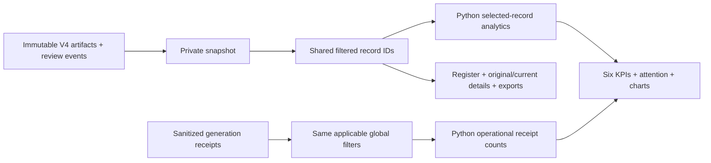

# V4.2 single-page engineering analytics

## Baseline and repository findings

Remote `feat/v42-premium-dashboard` was fetched and inspected at
`543321246beedb011b88cb7949d12eb795a15877`. Remote main was `1fc9630`, containing
merged V3 and single-generation replicate work. The compatible local engineering
extension at `4142fd5` already contained immutable generated-row imports, evidence
inspection, append-only review, schemas and private exports. Development branch:
`feat/v42-single-page-analytics`, based on that extension rather than discarding it.

Preserved: R Shiny/bslib, SQLite research and engineering stores, all prompt versions,
V4 inventory/audit logic, independent judge imports, statistics, Python financial
scenarios, the GitHub generation workflow and academic exports. Incomplete: primary
analysis was split across views and row filters did not control the larger dashboard.
Replaced: the six-page application shell and superseded private risk/summary outputs.
Added: a continuous light analytics surface and authoritative selected-record summaries.

The supplied Engineering Team Dashboard PNG was opened locally and inspected before
implementation. Its neutral canvas, white cards, thin borders, six compact metrics,
attention summary and paired/triple chart grids are the visual reference. The image
itself is not copied into the public repository.

## One page and one record selection

The application has four continuously visible sections: health, risk distribution,
AI performance/validation, and the full-width FMEA register. There are no primary
navigation tabs, sidebars or analysis routes. Global run, system, subsystem, model,
skill, date and review filters select the same private records used by the KPIs,
charts, register and filtered exports. Local column filters, text search and clicked
attention/matrix selections also apply to the analytics. Clear/Reset controls remove
those restrictions. Record details remain inline and follow the filtered selection.



`analysis.engineering.analytics` owns descriptive calculations. Shiny projects IDs,
formats values, sorts visual marks and selects pages; it does not calculate research
rates. An invalid/missing rating yields no RPN. A record without a citation is not
automatically a confirmed unsupported assertion. Scope is shown explicitly:

- Private row analytics count imported records, not every successful GitHub output.
- Operational activity uses sanitized generation receipts and stable IDs. Workflow
  retries are not counted as extra generations. Row-only subsystem/review filters
  cannot be asserted from generation metadata, so those operations show no matches.
- Historical V2 aggregates, full-cohort inferential results, financial scenarios and
  the academic poster are separately labeled study-level context, outside row filters.
- V4.1 and V4.2 remain dashboard revisions. No new skill treatment, prompt revision,
  performance observation or significance result was invented.

## Metric dictionary

| Quantity | Definition and missing-data behavior |
|---|---|
| Total failure modes | Number of selected imported row IDs. Replicates remain distinct; within-run duplicate checks are separate. |
| High severity | Current valid S >= 9 under existing integer 1–10 policy; visibility rule, not acceptance. |
| Average RPN | Arithmetic mean of valid current S x O x D only; valid denominator shown. No ratings are defaulted. |
| Evidence coverage | Usable citation present / selected rows. Not verified source support. |
| Validation pass | Current structurally passing rows / selected rows. Not engineering approval. |
| Engineering reviewed | Current APPROVED or REJECTED records. Reviewer identity remains self-asserted. |
| Engineering acceptance | Approved / approved-or-rejected rows within a compatible run; null when no decisions exist. |
| Duplicate rate | Extra exact original fingerprints / selected rows, within each run; independent replicas are not merged. |
| Scoring agreement | Within +/-1 among explicit human rating corrections on decided records; at least two pairs per rating. Approval alone does not create rating evidence. |
| Cause categories | Explicitly supplied category field only. Failure-mode categories are never repurposed as cause categories. |
| Corrective actions | Explicit recorded status and due date only; recommended text does not establish completion. |
| Duration | One recorded duration per successful generation, not repeated once per generated row. |

Empty selections have null percentages and average RPN. Unknown costs remain unknown.
Reference recall, precision, unsupported assertion rate and significance remain pending
without appropriate independent evidence. Comparisons are separated by dataset hash,
dataset version, workflow and scoring policy. Model/settings/skill hashes are retained.
The matrix displays row counts across S/O values, not a formal acceptance decision.
Priority ordering pins high-severity items even when sorting by RPN. No residual-risk
or FMECA-criticality-to-RPN conversion is inferred.

## Local operation (Windows / PowerShell / Positron)

From the repository root, use the existing R and Python dependencies.

```powershell
# Sanitized operational dashboard; private rows disabled.
Rscript -e ".libPaths(c('.venv/r-library',.libPaths())); shiny::runApp('dashboard',host='127.0.0.1',port=5385)"

# Trusted local engineering workstation; same single-page UI, private rows enabled.
Rscript dashboard/run_private.R
```

The private launcher uses port 5393. Explicitly import your own **generated V4**
artifacts first; actual file names must match your generation receipt:

```powershell
.\.venv\gemini\Scripts\python.exe -m analysis.engineering import-v4 --response results/pilot/v4_response.json --inventory results/pilot/inventory.json --receipt results/pilot/receipt.json --dataset-version input-package-r1
```

See [engineering integration](v42-engineering-integration.md) for the receipt contract,
review transitions and CLI exports. All private paths remain under ignored `results/`.
Never import reference FMEA/FMECA worksheets. An alternate database is selected with
`SIGMA_ENGINEERING_DATABASE` before launching. No automatic demo data is loaded.

The **Generate FMEA** button opens a configuration/instructions modal linking the
existing GitHub workflow. It does not dispatch a generation. A person must explicitly
authorize a single run through the established workflow. Registry synchronization and
independent judge import are unchanged:

```powershell
.\.venv\gemini\Scripts\python.exe -m analysis.research sync --metadata-only
.\.venv\gemini\Scripts\python.exe -m analysis.research preview-judge --file results/imports/judge_export.json
.\.venv\gemini\Scripts\python.exe -m analysis.research watch --interval 60
```

Shiny polls snapshots/databases every 30 seconds and supports manual refresh. Research
loading retains its last-known-good cache. Selected analytics are debounced and computed
once per selection, shared by chart outputs. The register renders ten records at a time;
the technical table scrolls inside its container. Selected JSON/CSV exports include the
whole filtered record set, not only its visible page. Empty/error/loading states remain
visible. No large-dataset throughput guarantee is claimed.

## Reviews, financial scenarios and academic exports

Click a row or priority bar to expand its inline original/current assessment, citations,
assumptions, findings and metadata. The review disclosure preserves explicit corrections,
approval confirmation, revision checks and append-only history. Original AI records are
never overwritten. Current filters remain in place after a decision.

Financial controls, scenarios and historical assumptions remain in an expandable section
on the same page. Python still computes every scenario. Negative savings are retained.
The final research-context disclosure contains methods, full-cohort inference, two
academic figures, presentation focus, notes and the existing PDF download.

```powershell
Rscript dashboard/export.R results/research/current.json results/single-page/academic
```

Dashboard colors are light and neutral; standalone academic export constructors/tokens
remain separate. No research data is manually inserted into figures or reports.

## Validation and limitations

Baseline suites: 223 Python tests and 82 R assertions passed before changes. New tests
exercise selected denominators, empty/invalid selections, rating agreement evidence,
duplicate scopes, operational deduplication, single-page markup and shared filters.

Validation completed during this implementation:

- Full Python suite: **229 tests passed**, 254.754 seconds. Focused adapter/analytics/
  hygiene tests were repeated after the final small presentation changes.
- Full R suite: **96 assertions passed**; verified subprocess exit 0. Existing Windows
  locale/package-build and restricted Sass-cache warnings remain non-fatal.
- Academic export: exit 0, producing **12 PNGs, 12 figure PDFs and one poster PDF**.
- Real-browser checks: one continuous page, six desktop KPI columns, no primary
  navbar/routes, shared system/model/review/search and matrix selections, filtered
  JSON export, empty intersections, and persisted synthetic approval with unchanged
  original values. Public mode exposed zero private rows and no invented metrics.
- Screenshots inspected at 1920x1080, 1440x900 and 1024x768. The first pass exposed
  Windows Unicode source decoding, KPI alignment and crowded table labels; these
  were corrected. Stable record IDs distinguish replicas in the register.
- A 50-iteration warm Python benchmark on 16 synthetic rows/two runs measured a
  0.30 ms median and 0.57 ms maximum. It excludes interpreter startup, browser latency
  and large-dataset throughput. This is not an experimental research result.

Preview gallery: `results/single-page/index.html`. Private previews are explicitly
synthetic; public previews use the existing sanitized operational snapshot. Screenshots,
generated artifacts and the gallery remain ignored, as required for this public repo.

```powershell
.\.venv\gemini\Scripts\python.exe -m unittest discover -s tests -q
Rscript dashboard/tests/run.R
```

Local screenshots and the synthetic demonstration gallery are under
`results/single-page/` and are not committed. Synthetic observations are prominently
labeled and never enter research aggregates. Public mode shows unavailable private
metrics rather than substituting receipt row counts or invented observations.

Private mode is loopback-only, opt-in and refuses forwarded/foreign-origin requests.
It is not an authenticated multi-user review service. Live independent evaluation,
authorized real V4 artifact imports and engineer acceptance remain external work.
No paid model calls, public deployment, push or merge are part of this implementation.
