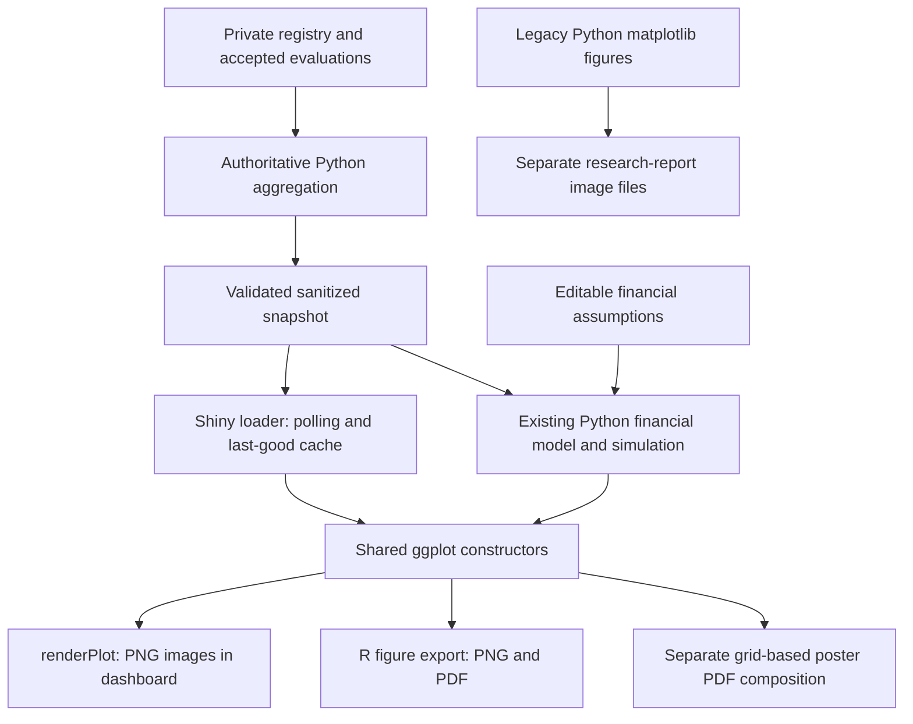

# V4.2 visual architecture audit

Audit date: 15 November 2026. Branch: `feat/fmea-skill-v4-research-dashboard`.
Source commit: `9cec0cb36fce2ad3461318756fac66e62186118b`.
Scope: diagnosis and recommendations only; no dashboard redesign or analytical changes.

## Finding

The clutter primarily comes from information hierarchy, report-style chart composition,
and insufficient separation between dashboard and poster rendering. CSS contributes,
but changing colors, borders, or card radii would leave the largest problems intact.
The current dark palette is already restrained. The application exposes too many
equally prominent metrics, repeats qualifications inside charts and surrounding UI,
and leaves detailed records and missing-data panels fully expanded.

The data graphics are a primary contributor, especially on small screens. The issue
is how ggplot figures are composed and sized for dashboard containers, rather than
ggplot2 itself. Preserve the analytical pipeline and academic ggplot figures. Add
purpose-specific rendering profiles and selective disclosure before considering a
different chart engine.

## Evidence and limits

The live application at `http://127.0.0.1:5385/` was already running. All six views
were rendered, captured, and visually inspected at 1920 x 1080, 1440 x 900, and
390 x 844 CSS pixels. Viewport and full-page screenshots were saved for every
combination. Rendered output error lists were empty for those captures; this does
not mean the views are visually correct. This is browser viewport emulation,
not a physical-phone test, cross-browser certification, or accessibility conformance audit.

The live snapshot was `8163c776d12d` (full identifier is recorded in the local source
manifest), updated `2026-11-15T17:01:12.724783+00:00`. It contains 14 generation
attempts, eight successful generations, six failures, eight awaiting judgment, and
zero accepted evaluations. These are operational records, separate from the
report-derived 18-run Round 1 aggregate. No observations were synthesized to fill
charts. Populated inferential/comparison layouts therefore have source-based risks,
not claimed visual validation with real evaluated V4 data.

Read: repository agent rules; V4.1 dashboard, metrics and validation documentation;
dashboard R, JavaScript, CSS, defaults, baseline fallback and tests; research finance
and export integration; shared financial/experiment plotting and simulation modules;
and existing visual/product guidance. The older light-paper direction in `DESIGN.md`
and appended dark-dashboard direction should eventually be reconciled.

The existing V4.1 preview index and financial screenshot were inspected. The PDF
was rasterized and visually inspected, with text extracted for verification. Fresh
live views were used as the authority: for example, the current Methodology view
includes the historical aggregate table, which is absent from its older gallery image.
The PDF footer identifies the same snapshot as the live dashboard.

All image links below are **local audit evidence in ignored `results/`**. They will
not resolve on GitHub unless separately shared through an approved mechanism.
No generated FMEA sheets, reference worksheets, or private judge records were opened.

### Screenshot matrix

Each cell links to the viewport image and the full page. Dimensions are requested
browser viewport dimensions; full-page image height varies with content.

| View | 1920 x 1080 | 1440 x 900 | 390 x 844 |
|---|---|---|---|
| Mission control | [Viewport](../results/v42-audit/desktop-mission-control-viewport.png) / [Full](../results/v42-audit/desktop-mission-control-full.png) | [Viewport](../results/v42-audit/laptop-mission-control-viewport.png) / [Full](../results/v42-audit/laptop-mission-control-full.png) | [Viewport](../results/v42-audit/mobile-mission-control-viewport.png) / [Full](../results/v42-audit/mobile-mission-control-full.png) |
| Experiment explorer | [Viewport](../results/v42-audit/desktop-experiment-explorer-viewport.png) / [Full](../results/v42-audit/desktop-experiment-explorer-full.png) | [Viewport](../results/v42-audit/laptop-experiment-explorer-viewport.png) / [Full](../results/v42-audit/laptop-experiment-explorer-full.png) | [Viewport](../results/v42-audit/mobile-experiment-explorer-viewport.png) / [Full](../results/v42-audit/mobile-experiment-explorer-full.png) |
| Engineering quality | [Viewport](../results/v42-audit/desktop-engineering-quality-viewport.png) / [Full](../results/v42-audit/desktop-engineering-quality-full.png) | [Viewport](../results/v42-audit/laptop-engineering-quality-viewport.png) / [Full](../results/v42-audit/laptop-engineering-quality-full.png) | [Viewport](../results/v42-audit/mobile-engineering-quality-viewport.png) / [Full](../results/v42-audit/mobile-engineering-quality-full.png) |
| Financial analysis | [Viewport](../results/v42-audit/desktop-financial-analysis-viewport.png) / [Full](../results/v42-audit/desktop-financial-analysis-full.png) | [Viewport](../results/v42-audit/laptop-financial-analysis-viewport.png) / [Full](../results/v42-audit/laptop-financial-analysis-full.png) | [Viewport](../results/v42-audit/mobile-financial-analysis-viewport.png) / [Full](../results/v42-audit/mobile-financial-analysis-full.png) |
| Research methodology | [Viewport](../results/v42-audit/desktop-research-methodology-viewport.png) / [Full](../results/v42-audit/desktop-research-methodology-full.png) | [Viewport](../results/v42-audit/laptop-research-methodology-viewport.png) / [Full](../results/v42-audit/laptop-research-methodology-full.png) | [Viewport](../results/v42-audit/mobile-research-methodology-viewport.png) / [Full](../results/v42-audit/mobile-research-methodology-full.png) |
| Presentation mode | [Viewport](../results/v42-audit/desktop-presentation-mode-viewport.png) / [Full](../results/v42-audit/desktop-presentation-mode-full.png) | [Viewport](../results/v42-audit/laptop-presentation-mode-viewport.png) / [Full](../results/v42-audit/laptop-presentation-mode-full.png) | [Viewport](../results/v42-audit/mobile-presentation-mode-viewport.png) / [Full](../results/v42-audit/mobile-presentation-mode-full.png) |

The matrix captures Explorer and Finance with sidebars collapsed, a state retained
in the browser session. Fresh sessions were checked separately with the default
desktop sidebars expanded: [desktop Explorer](../results/v42-audit/desktop-experiment-explorer-fresh-session.png),
[desktop Finance](../results/v42-audit/desktop-financial-analysis-fresh-session.png),
[laptop Explorer](../results/v42-audit/laptop-experiment-explorer-fresh-session.png),
[laptop Finance](../results/v42-audit/laptop-financial-analysis-fresh-session.png).
Do not mistake collapsed filters for missing functionality.

During repeated resize/toggle checks, sidebar layouts sometimes retained a
`transitioning` class with `.sidebar-content` at `display:none`, producing an empty
sidebar strip. Reloading restored the controls. Supplemental `*-sidebar-open.png`
images record that state; they are not evidence of a reliably completed expansion.
Investigate transition completion separately before attributing it to application
CSS or changing bslib. The fresh-session evidence avoids this ambiguity.

Measured document heights in the collapsed-sidebar capture set:

| View | Desktop px | Laptop px | Mobile px |
|---|---:|---:|---:|
| Mission control | 1,732 | 1,881 | 3,410 |
| Experiment explorer | 3,521 | 3,544 | 6,201 |
| Engineering quality | 3,868 | 3,869 | 4,977 |
| Financial analysis | 2,916 | 2,920 | 4,818 |
| Research methodology | 1,943 | 1,929 | 2,583 |
| Presentation mode | 1,227 | 1,238 | 2,773 |

Widths remained within the browser document area in these captures. That does not
establish readable content: inner tables scroll or clip, and text drawn inside
PNG plots is visibly cropped. Measurements are saved in
[`measurements.json`](../results/v42-audit/measurements.json); source and preview
hashes are in [`source-manifest.json`](../results/v42-audit/source-manifest.json).

### Representative evidence


## Charting architecture



Relevant source: [`app.R`](../dashboard/app.R), [`plots.R`](../dashboard/plots.R),
[`data.R`](../dashboard/data.R), [`poster.R`](../dashboard/poster.R),
[`export.R`](../dashboard/export.R), [`research.css`](../dashboard/www/research.css),
[`presentation.js`](../dashboard/www/presentation.js),
[`research/finance.py`](../analysis/research/finance.py), and
[`research/platform.py`](../analysis/research/platform.py).

### What renders where

| Graphic family | Current producer and live location | Assessment / recommended treatment |
|---|---|---|
| Generation activity | Python counts; `activity_plot`; Mission | **REFINE:** compact dashboard theme, integer count ticks, concise status legend; retain date meaning and attempt denominator. |
| Overall version comparison | Python summaries; `overall_plot`; Mission | **MOVE TO DETAIL VIEW:** current fallback is a full baseline-only coverage chart. Mission needs a compact current-quality state with a separate historical reference. |
| Per-run coverage comparison | `coverage_plot`; Engineering and Presentation; PNG/PDF exports | **KEEP** ggplot academic geometry; **REFINE** dashboard labels, width policy and empty states. Only show intervals from authoritative supported calculations. |
| Root-cause Pareto | Python category counts/percentages; `pareto_plot`; Engineering and Presentation | **KEEP** full academic Pareto; **REFINE** dashboard into readable horizontal categories, with cumulative detail available. Two axes, slanted labels, percentages and captions compete in the current small panel. |
| Field-level agreement | `field_accuracy_plot`; Engineering | **REFINE:** human-readable labels, remove one-entry legend, identify historical versus ingested cohort in the containing section. |
| Quality versus row count | `completeness_plot`; Engineering | **KEEP** investigative purpose; **REPLACE** empty axes with compact pending state. Consider hover/selection only after evaluated observations exist. |
| Manual versus AI annual cost | Python model; `financial_plot(comparison)`; Finance | **REPLACE** dashboard two-bar frame with a compact labeled comparison if space is scarce; retain ggplot export. Explicitly modeled, never measured savings. |
| Savings distribution | Python 10,000-draw simulation, precomputed histogram and interval; `financial_plot(simulation)` | **KEEP** as primary Finance figure; **REFINE** annotation hierarchy and responsive sizing. Assumption editing already provides meaningful interaction. |
| Cost by activity | Python activity costs; `financial_plot(breakdown)` | **MOVE TO DETAIL VIEW:** useful secondary horizontal bar chart, not mandatory alongside every other financial chart. |
| Scenario sensitivity | Python +/-20% scenarios; `financial_plot(sensitivity)` | **KEEP** interval semantics; **REFINE** labels and width. Do not turn absolute savings ranges into effect sizes without explicitly supplying the correct derived quantities. |
| Known billed spending | Python observed invoices; `spending_plot`; Finance | **REPLACE** full empty plot with compact unknown-spend notice until invoices exist; then **KEEP** chronological line. Unknown does not mean zero. |
| Review cost by version | Python quality-linked review estimates; `review_cost_plot`; Finance | **MOVE TO DETAIL VIEW**, show only supported evaluated comparisons; compact pending notice otherwise. |

There are 14 visible plot outputs across these views (2 Mission, 4 Engineering,
6 Finance, 2 Presentation), built from 12 chart families. Pareto is repeated in
Engineering and Presentation. With this snapshot, Mission's overall comparison
falls back to the same historical-baseline geometry used in Presentation. Reuse
of constructors is good; duplicating full figure furniture in every context is not.

All current live charts are **reactive ggplot2 renders**, delivered as PNG data
images by Shiny. None of these current view charts is an embedded Python report
PNG, SVG, or PDF. Python matplotlib modules under `analysis/experiments/figures.py`
and `analysis/financial_impact/{visualizations,operational_figures}.py` generate
separate report figures; they are not the live app's chart source. Existing static
PNG/PDF exports and `results/v41-previews/poster.pdf` are separate deliverables.
No Plotly integration or data-chart SVG renderer currently exists; UI icons may be SVG.

The same R constructors feed live views and figure/poster exports. The PDF has its
own grid composition, rather than being a browser print of Presentation mode.
Consequently, keeping the data consistent does not guarantee the web and PDF
layouts fit identically.

### Why resizing is insufficient

`app.R:100-114` measures output width, uses a 900px fallback and a 300px minimum,
and wraps labels below 600px only through `responsive_plot`. That wrapper is used
for Presentation and Pareto detail, but not Mission, the Engineering run/accuracy
plots, or Finance. Even the wrapped mobile Pareto still has overlapping labels.
Container width changes trigger raster rendering; they do not select a simpler
chart composition.

Plot heights are fixed at 280-350px. Engineering's run container is 350px with a
300px render; Pareto detail has a 330px container with a 300px render. Large titles,
subtitles, axes, bottom legends and captions leave very little space for marks.
Five-system `facet_wrap(..., nrow=1)` is a future narrow-screen risk in populated
coverage charts, identified from source rather than tested with invented data.

The plot theme uses point-sized type, independent of HTML typography. `res=120`
and the chosen raster device sizing yield conspicuously large labels in these
small panels; CSS font adjustments cannot fix text already drawn inside PNGs.
The CSS rule constraining image width prevents page overflow but cannot reflow
legends, annotations or category labels. Shiny supports explicit size functions,
resolution and alternative text; review them together rather than only increasing
the image resolution. [Shiny renderPlot documentation](https://shiny.posit.co/r/reference/shiny/latest/renderplot.html).

The dark plot theme is generally aligned with panel surfaces, but two exceptions
are visible: the no-matching-observations coverage branch uses a white background,
and the baseline pending annotation defaults to black on dark. Pareto facet labels
are also nearly invisible. These defects persist into exported figures. HTML uses
Georgia for page headings and sans-serif body text; plots use their own sans
defaults and the PDF uses its own font setup. Color and typography values are
duplicated across CSS, R themes and poster code.

## View-by-view diagnosis and improvement plan

### 1. Mission control

**Observed:** six equal KPIs place current operational counts beside historical
31.4% and approximate sigma 2, with an unavailable cost value taking equal space.
The qualification is present, but visual grouping still suggests one current
cohort. At desktop the target-progress heading starts around y=1,293, below the
first screen. Two oversized plot headings dominate before recent activity appears.
The recent table has 11 columns, long IDs and excessive numeric precision.
Laptop chart subtitles/captions clip. Mobile spends about 290px on global chrome
before the page content; activity labels and its legend clip, and the baseline
chart repeats information already present in the KPI strip.

**Plan:** **REFINE** into a progress-first landing page: successful generations,
evaluated generations, awaiting independent evaluation, and failures needing
attention; one compact generation-to-evaluation progress strip; recent activity
with system, version, short run label, lifecycle and timestamp. A compact quality
status follows, with an explicitly separate historical reference. **MOVE TO DETAIL
VIEW** sigma, costs, eight individual acceptance criteria, workflow diagnostics and
full identifiers. **REMOVE** duplicate chart titles and explanatory axis titles
when the section already supplies their meaning. Preserve denominators and caveats
in accessible descriptions/detail, not eight repeated disclaimers.

### 2. Experiment explorer

**Observed:** broad 11-column table and unrounded duration values read like a raw
export. All 14 attempts precede a permanently expanded metadata grid of roughly
29 fields and a 22-event lifecycle table. Some fields repeat status in different
forms. On mobile, only the first few table columns are immediately visible and the
full document reaches 6,201px. Fresh-session desktop filters consume a full sidebar;
collapsed state is represented by a small, weakly explained chevron. Row interaction
does not establish a strong visible selected-record hierarchy.

**Plan:** **KEEP** filtering and drill-down. **REFINE** to six primary columns,
readable durations/dates, labeled filter control and explicit selected-row state.
**MOVE TO DETAIL VIEW** hashes, full IDs, artifact metadata and event history in
an on-demand drawer/section. Use pagination or a bounded table and a mobile record
list; keep full values copyable. Do not shorten the actual stable identifiers.
Engineering quality currently consumes some Explorer filters without displaying
those controls locally: **REFINE** by showing active filter chips/reset or isolating
view filter state. Preserve the defined inference cohort when changing presentation.

### 3. Engineering quality

**Observed:** a bright white 300px empty chart immediately competes with historical
agreement bars. The agreement chart carries internal field names and a one-entry
legend. A second full empty chart, blank summary headings, pending tables and a
very long printed R statistics object create a 3,868px desktop page even with zero
ingested evaluations. Mobile axes collapse into a narrow strip, Pareto labels
overlap and large pending text clips. Historical evidence and current pending
results need more explicit grouping.

**Plan:** **REPLACE** empty plots with one semantic pending-evaluation section.
**KEEP** separately labeled historical evidence. **REFINE** into Coverage,
Failure causes, and Agreement/detail sections, one primary plot at a time on small
screens. **MOVE TO DETAIL VIEW** machine diagnostics and individual acceptance
checks; render readable inference status/method/sample-size fields instead of the
raw object. **REMOVE** empty standalone headings, not the underlying capabilities.
Keep extras labeled unmatched rather than adjudicated false positives.

### 4. Financial analysis

**Observed:** 13 scenario controls, six KPI values, six charts and long observed/
historical tables compete. Three unavailable spending KPIs repeat one missing-data
condition. Two empty charts add 560px of plotting space without observations.
Financial plots are meaningful analytical forms, but all six need not appear at
once. Long sensitivity labels use internal keys; titles and captions clip on laptop.
On mobile, neighboring `Unavailable` KPI values visibly collide and cost/sensitivity
axes become unreadable. The fresh desktop sidebar further reduces chart width;
raw high-precision manual-hour defaults are visually distracting.

**Plan:** **REFINE** around three clearly modeled outcomes: annual operating cost,
first-year savings with simulation interval, and break-even workload. Place the
savings distribution first. **MOVE TO DETAIL VIEW** cost breakdown, sensitivity,
billing completeness and preserved historical scenario. **REPLACE** three missing
spend KPIs with one measured-spending status, preserving unknown values. Group
assumptions into workload/labor, review, and advanced costs/uncertainty; keep Reset
and expose the active assumption summary. Display rounded values without changing
calculation precision. **KEEP** Python simulation, negative outcomes, reproducible
seed, distinction between modeled and measured, and scenario isolation from research
records. Avoid adding pan/zoom to a 40-bin histogram merely for visual novelty.

### 5. Research methodology

**Observed:** the 17-row historical table precedes the research process; on desktop
it occupies a narrow left strip with considerable unused horizontal space. The
page is less card-heavy than others but lacks a concise overview or anchor hierarchy.
Mobile table labels and narrative are readable overall, yet the long table delays
the explanation. Plain labels still expose awkward machine-derived wording.

**Plan:** **KEEP** readable prose and research limitations. **REFINE** to an initial
question and short generation/evaluation/analysis process diagram, followed by
method sections with anchors. **MOVE TO DETAIL VIEW** full historical dictionary
and extended statistical assumptions in expandable sections. Retain all 17 reported
quantities and provenance; improve labels, not reported values. Avoid adding cards
around every paragraph simply to fill the desktop width.

### 6. Presentation mode and PDF

**Observed:** shared plot annotations/legends/captions dominate a short chart area.
The pending annotation is black on dark in both browser and PDF. The academic
Pareto's two axes and slanted labels become unreadable on mobile. The browser view
is 1,227px tall on a 1080px desktop viewport before focus; it is a scrolling page,
not a fixed 16:9 composition. The PDF is genuinely 16:9, but uses tiny serialized
acceptance identifiers and internal status text. Eight pending tiles repeat one
research-stage message. Global export/focus actions also appear in every other view.

**Plan:** **KEEP** research question, data/method/results/discussion, two academic
ggplots and exact source snapshot. **REFINE** a dedicated 16:9 presentation canvas
with a separate mobile reading layout; ensure focus mode and PDF are both fitted
and inspected. Consolidate pending criteria in the main story, with all individual
criteria available in detail/notes. **REMOVE** internal enum strings and repeated
figure furniture from visible prose; retain human-readable evidence status and
required quantities/interval limitations. **MOVE TO DETAIL VIEW** presenter notes
and full criteria. Put presentation controls in this view; leave a compact global
refresh/status control elsewhere.

## Recommended information and component hierarchy

Preserve the six navigation destinations. Their order already matches the desired
research workflow sufficiently; reorganizing their contents matters more than
renaming all navigation or introducing a new sidebar shell.

```text
Application shell
  Brand + six destinations
  Compact snapshot/refresh status; synchronization error when relevant
Mission control
  Research stage + next action
  Generated / Evaluated / Awaiting judge / Failed
  Progress strip + recent generation activity
  Current quality state; separate historical reference
Experiment explorer
  Search + filter summary -> bounded record list -> selected record detail
Engineering quality
  Evidence cohort + local filters -> coverage -> causes/agreement -> diagnostics
Financial analysis
  Modeled outcome summary -> savings distribution -> secondary analyses
  Assumptions editor + explicit measured-spend state
Research methodology
  Question -> process -> evidence/method/limitations detail
Presentation mode
  Dedicated presentation composition + export/focus/notes
```

This is a presentation hierarchy proposal, not a new data model. Landing metrics
must remain tied to their actual cohort. Do not show the historical 18 judged FMEAs
as current accepted evaluations, or show eight unevaluated generations as quality
observations. Do not introduce a misleading `0/20 V4` progress calculation from the
unfiltered historical registry; use an explicitly selected experiment manifest.

## Plotting alternatives and chart-specific decisions

| Approach | Benefit | Limitation / recommendation |
|---|---|---|
| Custom ggplot dashboard theme | Smallest compatible change; shared geometry and export tooling; fixes title/legend/margin hierarchy | **REFINE first.** Introduce dashboard, presentation and publication profiles, including all empty-state branches. Responsive labels and facets require composition changes as well as a theme. |
| SVG output from ggplot | Crisp scalable text/marks and smaller vector exports for simple figures | **KEEP as an export option / pilot.** ggplot supports SVG devices; svglite produces web-oriented SVG. SVG does not automatically wrap labels, remove clutter or add interaction. Test fonts, security and caching before live adoption. |
| Plotly / ggplotly | Hover run identity, selecting points and linked exploration can be useful | **Selective REPLACE only if justified** for per-run coverage or row-count/quality scatter after real evaluated records exist. Adds widget payload, theming, accessibility and export work; conversion is not guaranteed to preserve every facet/annotation. Do not migrate all charts. |
| Lightweight HTML/SVG | Strong for accessible progress, compact comparisons and activity summaries | **REPLACE** simple baseline-only/empty graphic states and possibly two-value financial comparison. Consume existing calculated fields; do not implement a second statistics engine in JavaScript or R. |
| Hybrid | Keeps academic reproducibility while fitting operational UI | **Recommended:** ggplot for substantive analytical views and required poster figures, semantic HTML for status/progress, optional interactive scatter for a concrete exploration task. |

Technical references: [ggsave devices and sizing](https://ggplot2.tidyverse.org/reference/ggsave.html),
[svglite SVG device](https://svglite.r-lib.org/),
[Plotly R integration](https://plotly.com/r/). These capabilities support the options;
the recommendations above follow from this application's observed layouts.

Do not rescale missed percentage differently for each version to make improvement
look larger. Preserve comparable percentage scales, target definitions, pooled/mean
labels and supported intervals. For dashboard Pareto, a horizontal count chart can
reduce label pressure; keep the full cumulative academic figure for poster/export
and make cumulative values available without recalculating research metrics.

## Design-system recommendations

- **KEEP** near-black background, charcoal surfaces, cool cyan accent, limited amber/
  rose semantics, thin grid lines, no heavy gradients or ornamental animation.
- **REFINE** shared semantic tokens across HTML, ggplot and PDF: background, surface,
  primary/secondary text, grid, version colors, pending/error/success. Explicitly set
  every annotation/facet/empty-state color. Fix the observed black-on-dark defect first.
- **REFINE** operational typography toward one consistent sans family and a restrained
  three-level hierarchy. The current large Georgia headings can remain a deliberate
  poster/editorial treatment, but should not compete with even larger chart titles.
- **REFINE** spacing to a small 4/8px-derived scale, with 16-24px panel padding and
  clear section gaps. Use surfaces for grouping important content, not a bordered
  card for each number, warning or paragraph. Current clutter is not chiefly excessive
  decorative borders; oversized figure furniture and expanded detail matter more.
- **REFINE** KPI minimum widths and text wrapping. Unknown monetary values should be
  compact explanatory states, not large strings forced into two narrow columns.
  Use tabular numbers, humanized labels, sensible display precision and full-value copy.
- **REMOVE** one-entry legends, duplicate title/axis wording, empty headings and
  serialized developer enum strings from the primary visual layer. Keep necessary
  source/method/denominator qualifications accessible beside the chart or in detail.
- **REFINE** mobile composition explicitly: one primary visualization at a time,
  readable category labels, local filter sheet, bounded tables/record lists and no
  minimum raster width that exceeds the available inner area. Do not solve it by
  shrinking all text. Breakpoint decisions should follow measured content fit.
- **REFINE** accessibility: current chart images use generic `Plot object` alternative
  text. Supply meaningful evidence-aware descriptions and accessible tabular detail.
  Retain visible keyboard focus, add selected-row semantics, and validate contrast
  inside generated plots as well as CSS. No full keyboard/screen-reader audit was run.

## Ten highest-impact changes, in priority order

Effort estimates are engineering days including targeted regression checks, assuming
the existing pipeline remains intact. They overlap; do not sum them as a fixed quote.
S = up to 1 day; M = 1-3 days; L = 3-5 days.

| # | Classification | Proposed change and evidence | Complexity | Main risk / safeguard |
|---|---|---|---|---|
| 1 | REFINE | Progress-first Mission layout; equal weighting currently mixes current operations and historical quality, with targets below the fold | M | Mislabeling cohorts; retain explicit historical/current separation and manifest-scoped progress |
| 2 | MOVE TO DETAIL VIEW | Collapse raw statistics, provenance fields, event history and financial dictionaries; Explorer 6,201px mobile, Quality 3,868px desktop | M | Hiding essential audit evidence; preserve accessible drill-down and full copy/export values |
| 3 | REFINE | Separate dashboard/presentation/publication plot profiles; fix black annotations, white empty plot, large titles and unnecessary legends | M | Academic export regressions; share data/geometry, compare both PNG/PDF and live views |
| 4 | REPLACE | Compact semantic pending/unknown states instead of full empty plots and repeated unavailable KPIs | S-M | Conflating missing with zero/failed; distinct states and evidence-aware descriptions |
| 5 | REFINE | Responsive chart composition and KPI fit across all outputs, not just three wrapped plots | L | Changing scales/cohort or losing labels; verify all 18 view/size combinations with supported fixtures |
| 6 | REFINE | Finance: three modeled outcomes and primary distribution, secondary plots on demand | M | Mistaking projections for verified savings; persistent modeled label and interval terminology |
| 7 | MOVE TO DETAIL VIEW | Group advanced financial assumptions and preserved historical scenario; keep basic controls/reset nearby | M | Breaking scenario reactivity/reset; preserve Python boundary and test unchanged input precision |
| 8 | REFINE | Explorer six-column primary list, rounded display, selected-record drawer and visible filter state | M-L | Stable ID selection or hidden cross-view filters; preserve original IDs and explicit active-filter summaries |
| 9 | REFINE | Shared visual tokens, shorter operational headings, meaningful plot alt text and readable labels | M | Font/platform differences; inspect Windows live rendering and PDF font output |
| 10 | REFINE | Dedicated 16:9 presentation composition, local export controls, concise pending criteria and mobile reading mode | L | Poster requirements lost while simplifying; retain two ggplots, five content sections, data provenance and all criteria in detail |

**KEEP** the six capabilities, authoritative Python metrics, stable registry IDs,
independent evaluation boundary, version separation, Monte Carlo implementation,
last-known-good validation/cache and privacy allowlist. **REMOVE** visual duplication
only; never remove uncertainty, missing-data distinctions or research provenance.

## Implementation sequence and verification risks

1. Fix plot contrast/empty-state inconsistencies and define rendering profiles.
2. Reorder Mission and introduce bounded detail components, without changing data APIs.
3. Simplify Finance and make responsive plot policies consistent across every output.
4. Refine Explorer filters/selection and Engineering detail hierarchy.
5. Fit Presentation/PDF independently; finish accessibility and responsive regression review.

A realistic complete refinement is approximately 8-12 engineering days including
visual regression and export checks; a first high-impact pass on priorities 1-4 is
approximately 3-5 days. Interactive-widget migration would be additional work and
is unnecessary for that first pass.

Required follow-up checks: all 18 view/viewport combinations; expanded/collapsed and
fresh-session sidebars; 200% zoom; keyboard navigation/selected rows; last-good
refresh; pending, failed and evaluated states using explicitly synthetic tests;
unchanged Python metrics/snapshot schema; finance input/reset and unknown costs;
poster page dimensions, label clipping, fonts and required content. No paid models
are needed for these checks. Do not call a populated V4 screen real research evidence
until comparable accepted evaluations exist.

## What this audit changed and verified

- Created this document and ignored screenshot/measurement/PDF-render evidence only.
- Captured 36 primary screenshots (18 viewport and 18 full-page), plus sidebar and
  fresh-session checks; inspected the prior financial screenshot and rendered PDF.
- Reviewed source and actual browser output; no research data, metrics, generator,
  judge ingestion, dashboard source or poster implementation was changed.
- Final hash verification found no changes to the inspected source/data/preview
  files. All local document links resolved, 36 primary screenshots were present,
  and `git diff --check` passed. Git status showed only this new audit document.
- The supplementary source detector returned no findings for `app.R`/CSS. It does
  not understand bitmap plot labels or the observed information hierarchy; that
  result is not a visual pass.
- Python/R suites were not rerun for this documentation-only audit. The prior V4.1
  validation report records 209 Python tests and 26 R assertions; those are historical
  results, not new tests performed here.
- No paid models, workflow dispatch, push, merge or deployment occurred. The local
  audit images remain ignored; no public publication is implied.

## Answer to the graphics question

Yes: the existing data graphics are one of the primary causes of clutter because
report-scale typography, captions, axes, legends and pending annotations occupy
small fixed-height dashboard panels. The screenshots show cropping and low contrast,
not merely a preference for a different aesthetic. The expanded diagnostics and
equal-weight component hierarchy are equally consequential. A targeted hybrid
refinement, while preserving ggplot2 for research and poster figures, addresses
these causes more directly than a wholesale Plotly rewrite or CSS-only reskin.
