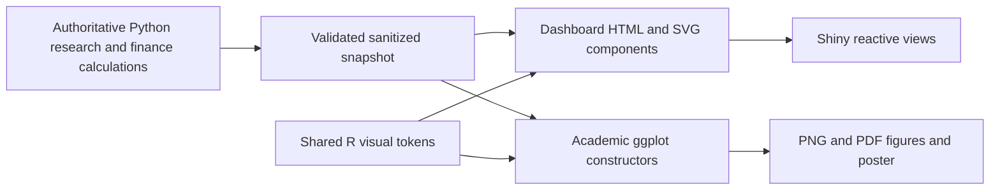

# V4.2 analytics visualization refactor

Starting branch: `feat/fmea-skill-v4-research-dashboard`.
Starting commit: `9cec0cb36fce2ad3461318756fac66e62186118b`.
Design evidence: [completed visual audit](v42-visual-audit.md).

## Implemented architecture



`dashboard/charts.R` is presentation code: selection, formatting, mark positioning
and visual scaling. It does not calculate missed rates, confidence intervals,
version effects, category percentages, costs or simulation draws. Python's snapshot
and existing scenario subprocess remain authoritative. The only fraction-to-percent
conversion is presentation of historical conditional-quality proportions, as before.

`dashboard/plots.R` remains the academic layer. The existing export command and poster
renderer still use its ggplot constructors. The new `dashboard/theme.R` supplies
semantic colors and version palette to both rendering layers and CSS variables to
the app. No Plotly dependency, remote font or browser-side statistics engine was added.

## Component changes

| Component | Dashboard treatment | Evidence boundaries |
|---|---|---|
| Generation activity | Compact SVG status bars, date endpoints, hover counts; individual pending receipt dots | Python-counted generation activity, not workflow-success totals. Pending dots are successful receipt subsets, not extra attempts. |
| Evaluated runs | System-grouped SVG points, version colors, 20% reference, hover identity and keyboard/click selection | Only accepted run records. No historical aggregates become individual points. |
| Version comparison | Compact percentage bars with supplied sample sizes and interval text | Equal-system means; missing versions remain pending. Historical pooled V2 reference is a separate disclosure. |
| Root causes | Horizontal count bars with count and supplied percentage | Four named miss categories; unclassified cases remain visible when present. No dual axis in dashboard. |
| Agreement | Horizontal percentage bars with tolerance in each label | Cause/effect agreement differs from ratings within +/-1 and RPN within 25%. Conditional denominators remain available in detail. |
| Financial comparison | Two compact annual-cost bars and three scenario outcomes | Modeled operating cost, first-year savings, break-even workload and review cost remain distinct from actual expenses. |
| Monte Carlo | Responsive SVG histogram with zero reference, median and supplied 95% simulation interval | Existing Python bins/draws; negative outcomes retained. Interval is not an observed-savings confidence interval. |
| Financial detail | Expandable cost drivers/sensitivity; shared-range sensitivity marks; timestamped invoice trend when supported | No invoices produces an explicit unknown state. Review-cost comparisons require accepted evaluations. |

Charts use parent headings, muted labels, subtle grid references and native browser
hover titles. SVG points and bars are focusable; run points support Enter/Space and
open a selected-run metadata section. Underlying values are available in expandable
tables for touch, keyboard and detailed inspection. These are native tooltips, not
a linked cross-chart exploration system.

Financial assumptions now open in a responsive inline editor instead of a sidebar
that can obscure mobile charts. The same controls, exact defaults, 700ms debounce,
Python model boundary and Reset behavior remain. Secondary research tables and raw
inference details remain available in disclosures rather than occupying the initial
Engineering Quality view. Six navigation capabilities are retained.

## Removed obsolete dashboard implementations

- Removed live `renderPlot` bindings for activity, overall/version comparison,
  run coverage, dashboard Pareto, agreement, completeness and six financial charts.
- Removed their fixed-height `plotOutput` card layouts and dashboard-only use of
  report titles, axis/legend furniture and full-sized missing-data plots.
- Removed the unused `output$overall` binding.
- Replaced repeated unknown-cost KPI blocks with an explicit measured-spending state.
- Kept all academic constructors: they are still used by downloadable PNG/PDF exports.
  Presentation mode retains two ggplots, with a smaller web presentation profile.

Academic fixes include explicit annotation/facet colors, a dark missing-observations
branch, shared theme colors, and smaller web-poster figure furniture. Export titles,
captions, target definitions, geometry and statistical inputs remain available.

## Validation and previews

The real local snapshot remains `8163c776d12d`: 30 workflow metadata records from a
partial/rate-limited backfill; 14 historical generation attempts; eight successes,
six failures, eight awaiting judge; zero accepted evaluations. These are separate
from the 18-run historical report. No new generation or evaluation was performed.

Tests use explicitly synthetic evaluated data to exercise point identity, supplied
intervals, negative financial outcomes and escaping; those fixtures are never
published as research observations. Renderer tests check serialized input equality
before/after construction. Existing validation/cache, scenario/reset and academic
export tests remain in place.

Commands from repository root, PowerShell:

```powershell
.\.venv\gemini\Scripts\python.exe -m unittest discover -s tests -q
Rscript dashboard/tests/run.R
Rscript dashboard/export.R results/research/current.json results/v42-refactor/academic
Rscript dashboard/benchmark.R results/research/current.json results/v42-refactor/performance.json
Rscript -e ".libPaths(c('.venv/r-library',.libPaths())); shiny::runApp('dashboard',host='127.0.0.1',port=5388,launch.browser=FALSE)"
```

The baseline Python suite exposed an existing stale expectation in the truncation
test: offline reporting now produces a reporting receipt and metrics directory.
The test now explicitly expects those existing sidecars and additionally verifies
failed/truncation status and absence of a CSV. Generator code was not changed.

Final verification: **209 Python tests passed; 60 R assertions passed**. Academic
export completed with **12 PNG figures, 12 figure PDFs and one poster PDF**. All
18 final browser view/size captures had zero Shiny output errors. Expanded financial
detail was also rendered and inspected at desktop/mobile sizes. The only browser
resource error observed was the existing missing favicon; R emits existing locale,
package-build and fallback-cache warnings.

Protected inspected Python calculation modules, sanitized current snapshot and prior
V4.1 preview artifacts retained their audit-time hashes. R serialization checks also
confirm dashboard constructors do not mutate their input datasets. This verifies
presentation/data consistency, not new experimental efficacy.

All following artifacts are **ignored local files**, not committed research outputs.
Before images come from the audit of the starting commit. After images use the
same sanitized snapshot. An image showing pending evaluation is not a missing test.

| View | Before desktop | After desktop | After mobile |
|---|---|---|---|
| Mission | [Before](../results/v42-audit/desktop-mission-control-full.png) | [After](../results/v42-refactor/desktop-mission-full.png) | [Mobile](../results/v42-refactor/mobile-mission-full.png) |
| Engineering quality | [Before](../results/v42-audit/desktop-engineering-quality-full.png) | [After](../results/v42-refactor/desktop-quality-full.png) | [Mobile](../results/v42-refactor/mobile-quality-full.png) |
| Financial analysis | [Before](../results/v42-audit/desktop-financial-analysis-full.png) | [After](../results/v42-refactor/desktop-financial-full.png) | [Mobile](../results/v42-refactor/mobile-financial-full.png) |
| Presentation | [Before](../results/v42-audit/desktop-presentation-mode-full.png) | [After](../results/v42-refactor/desktop-presentation-full.png) | [Mobile](../results/v42-refactor/mobile-presentation-full.png) |


All six views also have `desktop`, `laptop`, and `mobile` viewport/full screenshots
in `results/v42-refactor/`, at 1920x1080, 1440x900 and 390x844. The preview gallery
there links all views, expanded financial graphics, and academic exports.

Export outputs include 12 figure families in PNG/PDF and `academic/poster.pdf`.
They use the same validated snapshot. No public deployment or sanitized-data
publication was performed.

## Performance measurement

`dashboard/benchmark.R` records five warm R construction samples per component and
HTML/SVG byte counts. On this workstation the initial sample medians were 0-50ms
(timer resolution limits the zero readings), with the histogram about 10.2KB and
the activity component about 3.5KB including pending receipt marks. These are
component construction measurements, not browser latency, cold-start time, model
runtime or a claimed end-to-end speedup. See the generated JSON for exact values.

The dashboard no longer creates plot PNGs for its operational/quality/financial
charts; Shiny still renders two academic presentation plots. Input changes still
invoke the existing financial subprocess, whose duration is separate from chart
construction. Detail tables are constructed server-side even while collapsed;
future large-cohort pagination remains a performance consideration.

## Limits and remaining work

- Real accepted V4 evaluation charts remain pending; synthetic rendering tests
  verify presentation behavior without inventing findings.
- Explorer's wide metadata table and full provenance grid are retained outside this
  analytical-chart scope. Their separate audit recommendations remain applicable.
- Physical-phone and cross-browser accessibility certification are not claimed.
- R reports locale/package-build warnings on this workstation; the documented tests
  and exports still complete. Native SVG titles offer limited touch interaction;
  supporting tables provide the full accessible values.
- Existing Python inference, metric definitions, judge ingestion, financial
  simulation assumptions, baseline records and generator versions remain unchanged.
