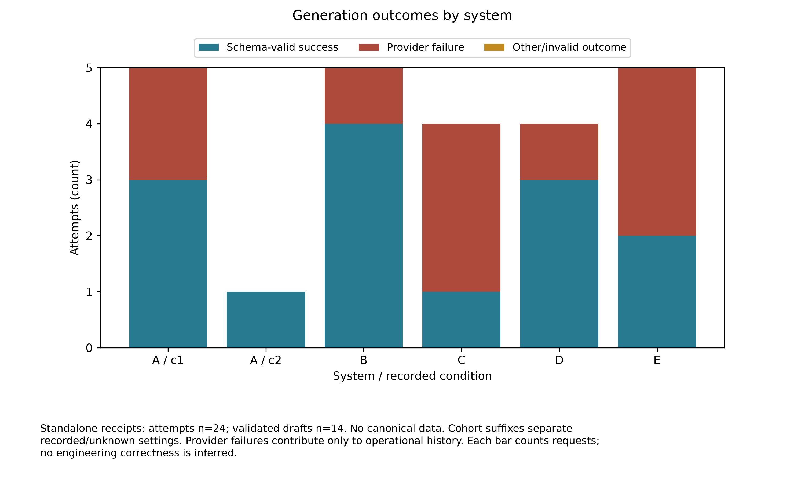
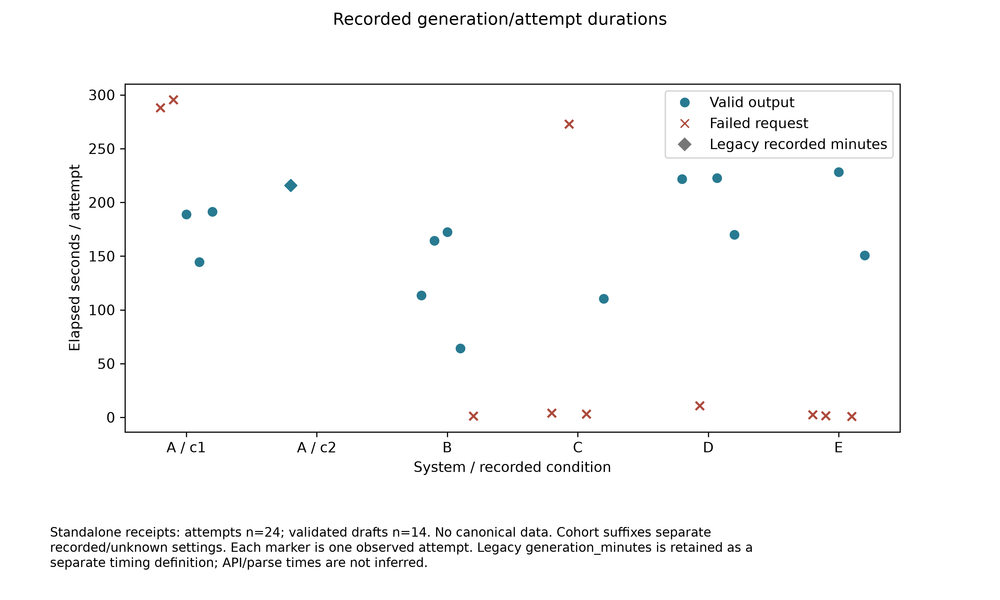
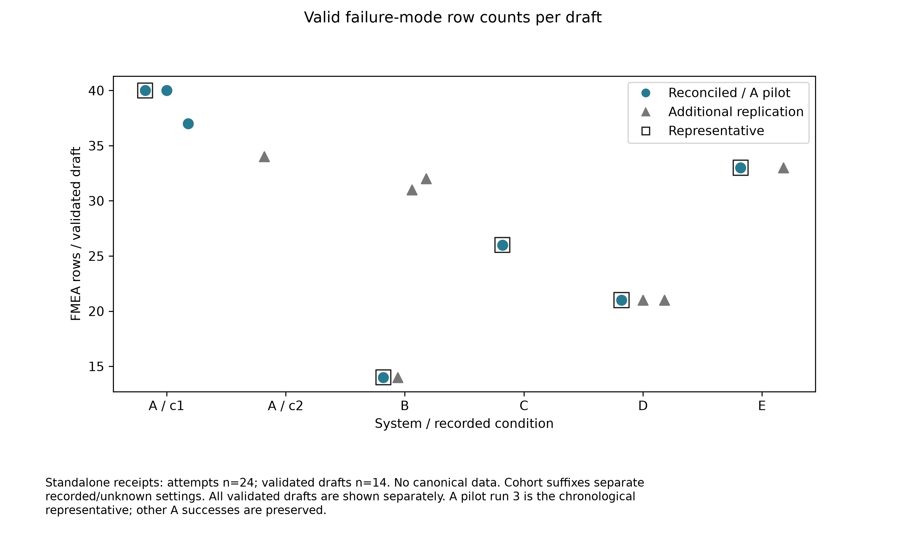
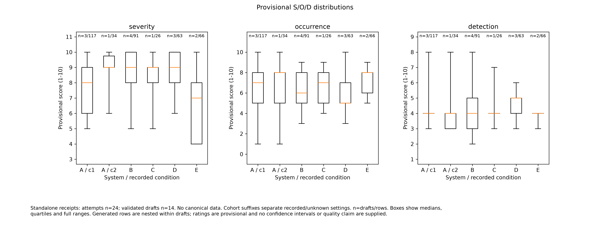
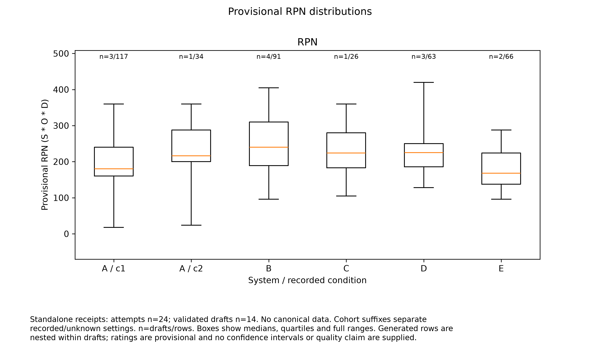
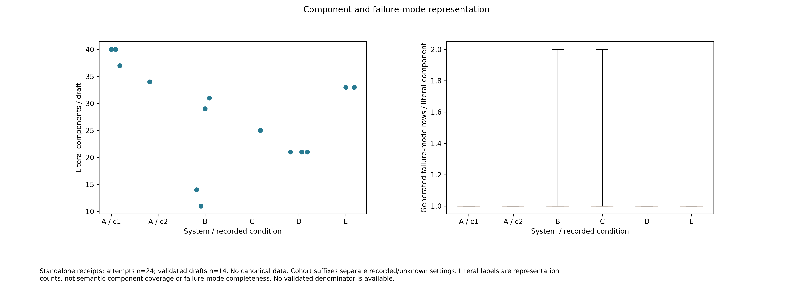
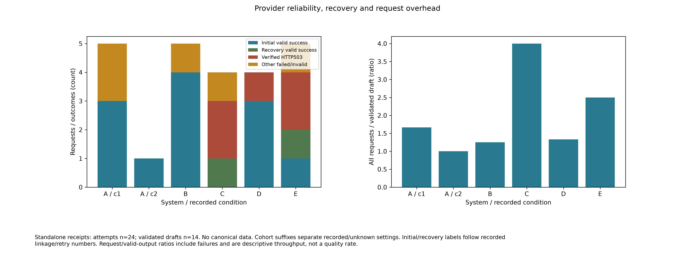
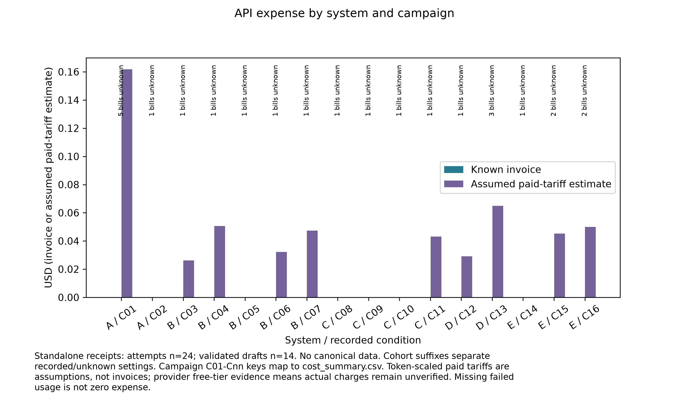
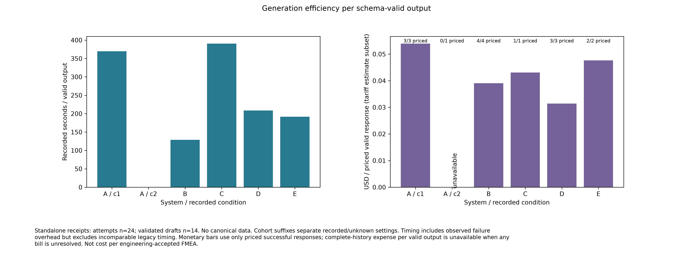
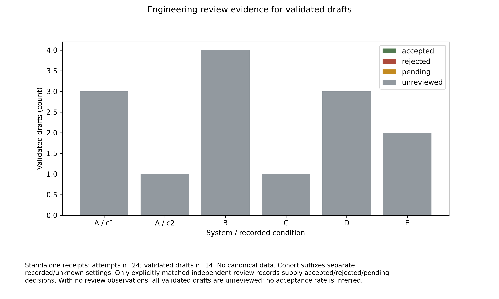

# Standalone FMEA experiment dashboard

**Preliminary AI-assisted analytical working report; engineering ratings remain provisional.**

Attempts: **24**; validated drafts: **14**; primary dataset outputs: **7**; selected five-system representatives: **5**.
The primary dataset preserves all successful A pilot replications and the latest reconciled B-E selections. Additional B/D/E replications and the earlier receiptless A run remain separate observations. Canonical research is excluded.
A pilot run 3 is the chronological representative where supplied by the A-E index. Unknown legacy settings are separate conditions. Provider failures have no FMEA ratings or engineering-review denominator.

## Overall FMEA Run Health

These are operational counts, not engineering acceptance or proof of correctness. Failed requests contribute no FMEA observations.

| System | Attempts | Valid drafts | Failed requests | Verified HTTP 503 | Verified HTTP 429 | Engineering review |
|---|---:|---:|---:|---:|---:|---|
| A | 6 | 4 | 2 | 0 | 0 | Unreviewed |
| B | 5 | 4 | 1 | 0 | 1 | Unreviewed |
| C | 4 | 1 | 3 | 2 | 0 | Unreviewed |
| D | 4 | 3 | 1 | 1 | 0 | Unreviewed |
| E | 5 | 2 | 3 | 2 | 1 | Unreviewed |

Total: **24 attempts, 14 valid drafts, 10 failed requests**; five verified HTTP 503 and two HTTP 429 failures. Other failures remain operational records. The 7-output primary dataset and additional successful replications are distinguished in the dashboard.

No acceptance rate or component completeness is inferred. The source package has no measured labor, invoice or independent engineering-review observations. All actual bills remain unknown.

## Data audit

| Input | Count |
|---|---:|
| manifests_loaded | 7 |
| unique_attempts | 24 |
| successful_generations | 14 |
| failed_generations | 10 |
| attempts_with_duration | 24 |
| attempts_with_usable_tokens | 13 |
| attempts_with_invoice_expense | 0 |
| attempts_with_estimated_expense | 13 |
| attempts_with_unknown_actual_billing | 24 |
| attempts_without_priced_amount | 11 |
| manual_labor_observations | 0 |
| all_labor_observations | 0 |
| engineering_review_observations | 0 |
| independent_acceptance_decisions | 0 |
| validated_csv_outputs | 14 |
| primary_dataset_outputs | 7 |
| representative_outputs | 5 |
| canonical_attempts_included | 0 |

## Observed operational dashboard

### 01 generation success

Provider failures contribute only to operational history. Each bar counts requests; no engineering correctness is inferred.

### 02 generation duration

Each marker is one observed attempt. Legacy generation_minutes is retained as a separate timing definition; API/parse times are not inferred.

### 03 fmea rows

All validated drafts are shown separately. A pilot run 3 is the chronological representative; other A successes are preserved.

### 04 sod distributions

n=drafts/rows. Boxes show medians, quartiles and full ranges. Generated rows are nested within drafts; ratings are provisional and no confidence intervals or quality claim are supplied.

### 05 rpn distributions

n=drafts/rows. Boxes show medians, quartiles and full ranges. Generated rows are nested within drafts; ratings are provisional and no confidence intervals or quality claim are supplied.

### 06 component representation

Literal labels are representation counts, not semantic component coverage or failure-mode completeness. No validated denominator is available.

### 07 provider reliability

Initial/recovery labels follow recorded linkage/retry numbers. Request/valid-output ratios include failures and are descriptive throughput, not a quality rate.

### 08 api expense

Campaign C01-Cnn keys map to cost_summary.csv. Token-scaled paid tariffs are assumptions, not invoices; provider free-tier evidence means actual charges remain unverified. Missing failed usage is not zero expense.

### 09 generation efficiency

Timing includes observed failure overhead but excludes incomparable legacy timing. Monetary bars use only priced successful responses; complete-history expense per valid output is unavailable when any bill is unresolved. Not cost per engineering-accepted FMEA.

### 10 engineering review

Only explicitly matched independent review records supply accepted/rejected/pending decisions. With no review observations, all validated drafts are unreviewed; no acceptance rate is inferred.

## Financial evidence and missing inputs

[Financial report](Financial_Impacts.md) / [All financial figures](financial_figures.md).
Known token counts can be scaled by the configured paid tariff as an explicit estimate. Provider free-tier quota evidence is retained; paid-tariff amounts are not observed invoices. Unknown failed usage and actual billing are never zero.
Empirical economics require closed manual development/review/approval time, AI preparation/supervision/review/rework time, equivalent scope/criteria and independently accepted matched cases, invoice reconciliation, skill maintenance/development expense and annual workload. Elapsed generation time is not active labor.
No approved complete financial scenario is supplied by default. Fill the editable scenario template and explicitly pass --scenario to reuse the existing Monte Carlo, sensitivity and break-even model. Simulation intervals are not empirical confidence intervals.
## Reproducibility

Tables preserve every attempted request and separate validated outputs from primary selections. Artifacts are SHA-256 checked. No coverage fraction is inferred without a validated denominator. No reference FMEA was read.
