# Financial Figures

**Actual generated PNG figures, published for review. Preliminary AI-assisted analysis; all FMEA ratings remain provisional.**

[Report index](README.md) | [Financial analysis](Financial_Impacts.md) | [Assumptions and sources](assumptions_and_sources.md)

Figures 07-13 contain observed operational data and explicitly labeled paid-tariff estimates. Figures 01-06 identify missing labor, independent acceptance or scenario inputs; they do not represent zero cost or measured savings. No approved Monte Carlo scenario was supplied.

The source history contains 24 attempts, 14 schema-valid drafts and 10 failures. Thirteen attempts have usable tokens, producing a $0.550623 assumed paid-tariff subtotal. Actual billing remains unknown for all 24 attempts; 11 have no priceable amount.

## 01 before after cost

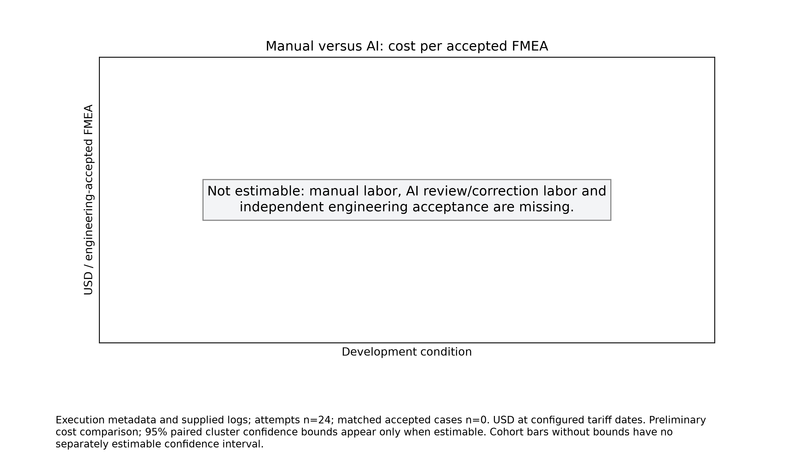

Preliminary cost comparison; 95% paired cluster confidence bounds appear only when estimable. Cohort bars without bounds have no separately estimable confidence interval.

[Download full-resolution PNG](financial-figures/01_before_after_cost.png)

## 02 labor breakdown

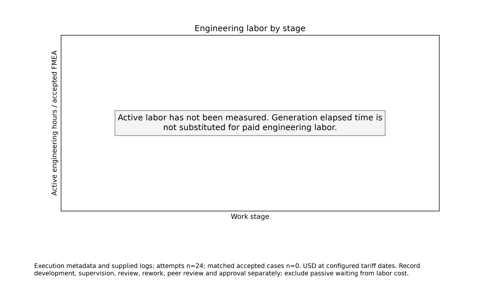

Record development, supervision, review, rework, peer review and approval separately; exclude passive waiting from labor cost.

[Download full-resolution PNG](financial-figures/02_labor_breakdown.png)

## 03 savings bootstrap

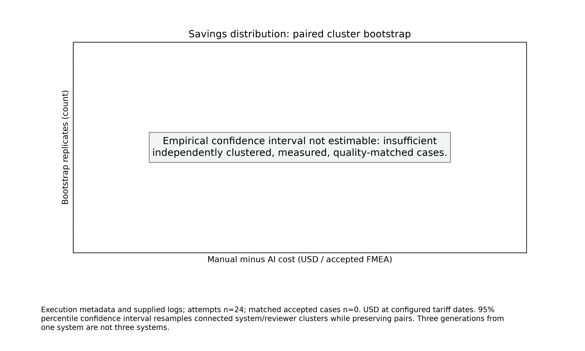

95% percentile confidence interval resamples connected system/reviewer clusters while preserving pairs. Three generations from one system are not three systems.

[Download full-resolution PNG](financial-figures/03_savings_bootstrap.png)

## 04 cost sensitivity

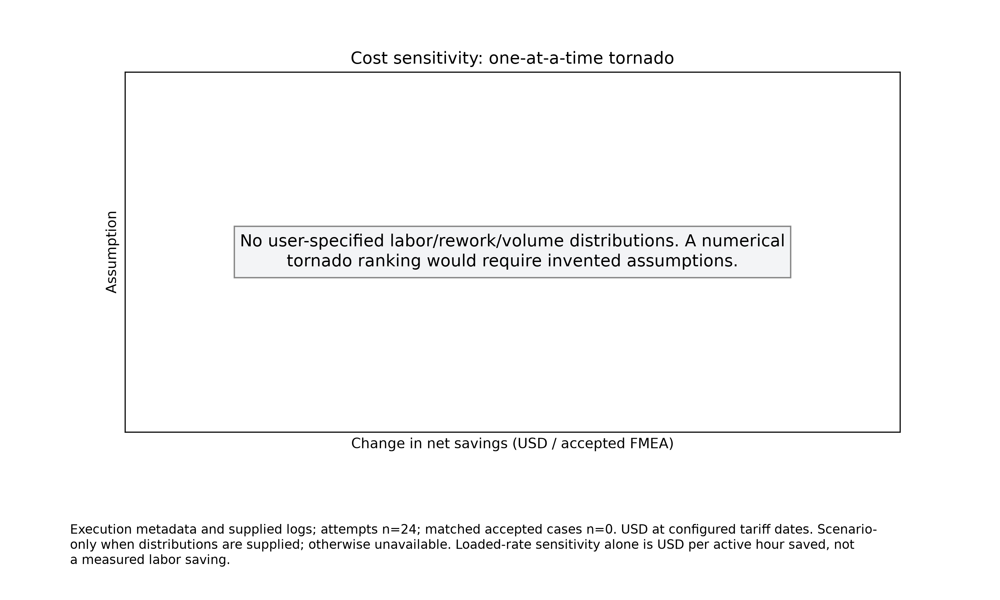

Scenario-only when distributions are supplied; otherwise unavailable. Loaded-rate sensitivity alone is USD per active hour saved, not a measured labor saving.

[Download full-resolution PNG](financial-figures/04_cost_sensitivity.png)

## 05 break even

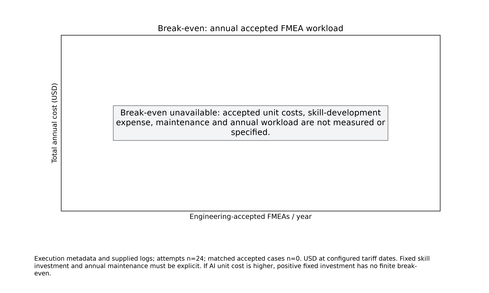

Fixed skill investment and annual maintenance must be explicit. If AI unit cost is higher, positive fixed investment has no finite break-even.

[Download full-resolution PNG](financial-figures/05_break_even.png)

## 06 skill versions

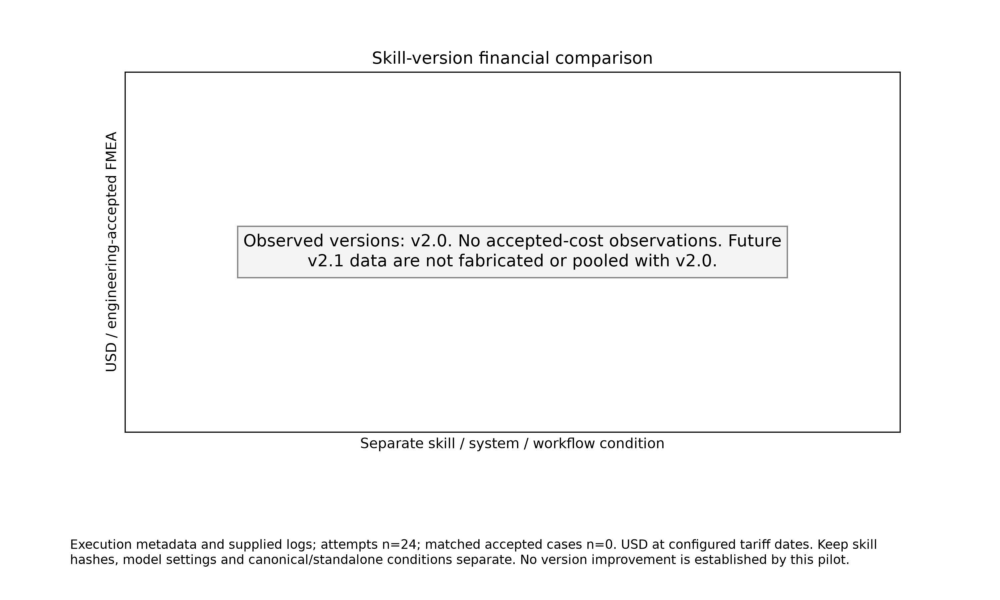

Keep skill hashes, model settings and canonical/standalone conditions separate. No version improvement is established by this pilot.

[Download full-resolution PNG](financial-figures/06_skill_versions.png)

## 07 observed generation

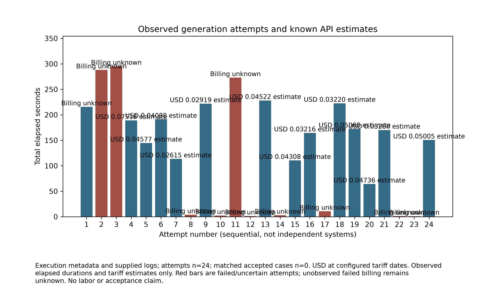

Observed elapsed durations and tariff estimates only. Red bars are failed/uncertain attempts; unobserved failed billing remains unknown. No labor or acceptance claim.

[Download full-resolution PNG](financial-figures/07_observed_generation.png)

## 08 observed duration

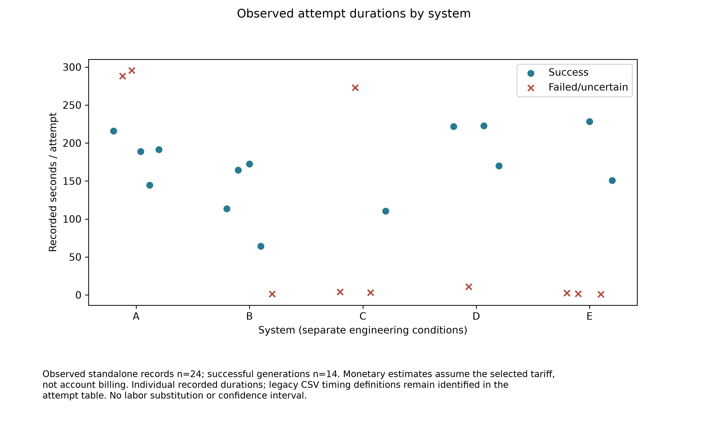

Individual recorded durations; legacy CSV timing definitions remain identified in the attempt table. No labor substitution or confidence interval.

[Download full-resolution PNG](financial-figures/08_observed_duration.png)

## 09 observed tokens

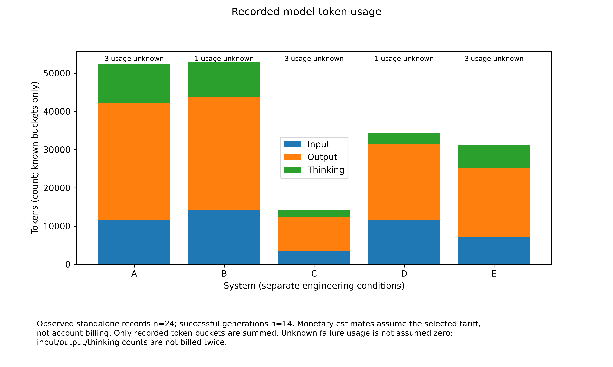

Only recorded token buckets are summed. Unknown failure usage is not assumed zero; input/output/thinking counts are not billed twice.

[Download full-resolution PNG](financial-figures/09_observed_tokens.png)

## 10 observed failure overhead

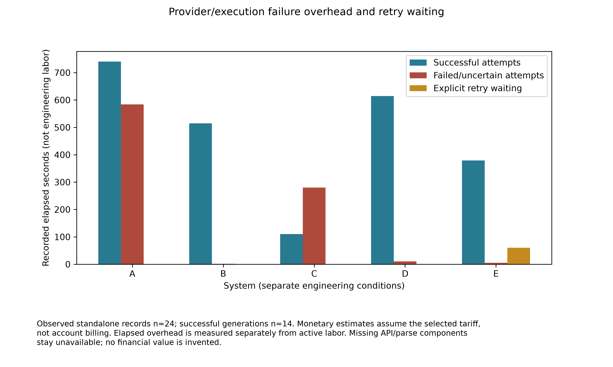

Elapsed overhead is measured separately from active labor. Missing API/parse components stay unavailable; no financial value is invented.

[Download full-resolution PNG](financial-figures/10_observed_failure_overhead.png)

## 11 observed retries

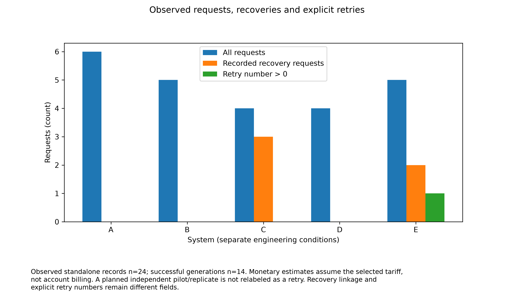

A planned independent pilot/replicate is not relabeled as a retry. Recovery linkage and explicit retry numbers remain different fields.

[Download full-resolution PNG](financial-figures/11_observed_retries.png)

## 12 observed api expense

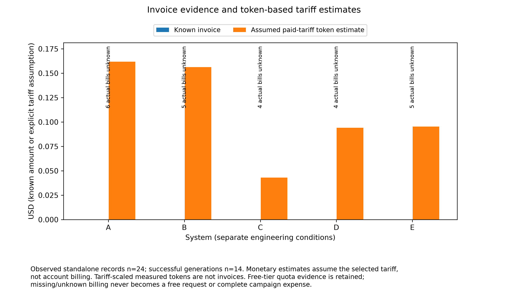

Tariff-scaled measured tokens are not invoices. Free-tier quota evidence is retained; missing/unknown billing never becomes a free request or complete campaign expense.

[Download full-resolution PNG](financial-figures/12_observed_api_expense.png)

## 13 observed generation efficiency

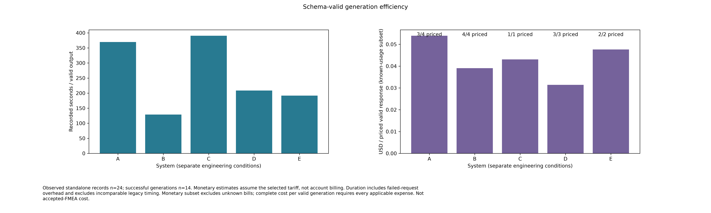

Duration includes failed-request overhead and excludes incomparable legacy timing. Monetary subset excludes unknown bills; complete cost per valid generation requires every applicable expense. Not accepted-FMEA cost.

[Download full-resolution PNG](financial-figures/13_observed_generation_efficiency.png)
